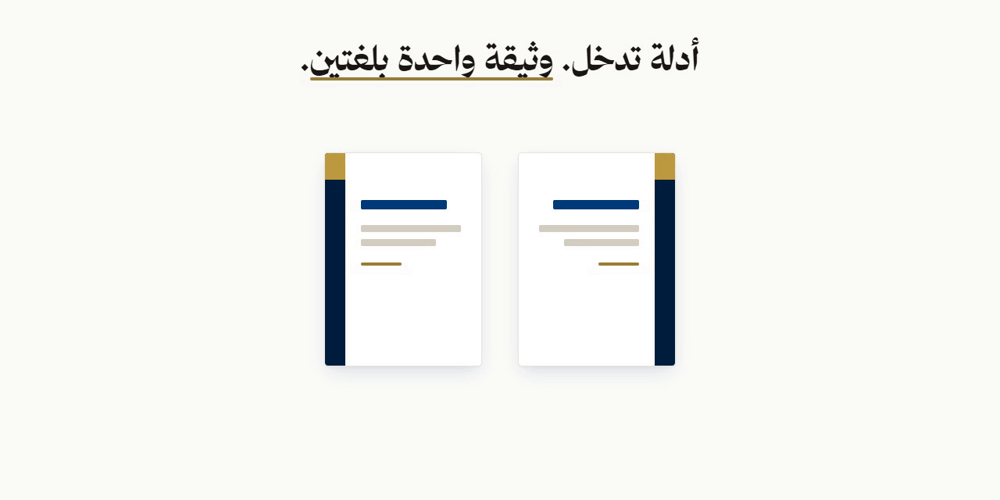
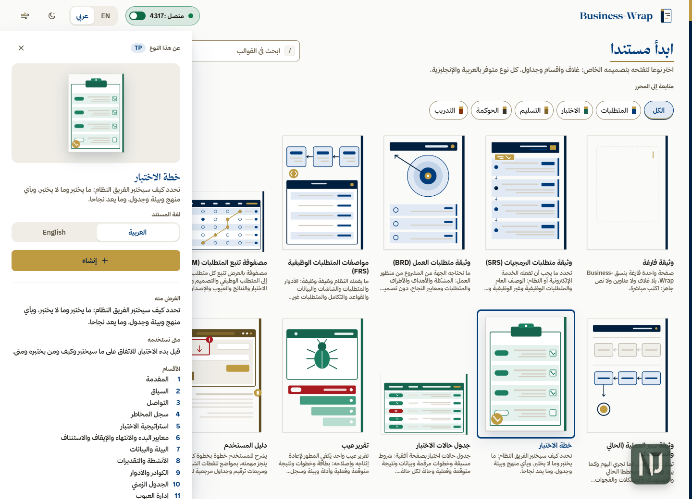

<div dir="rtl">

<h1 align="center">📄 أدلة تدخل، ووثيقة تخرج</h1>

<h3 align="center">بزنس راب (Business-Wrap): استوديو وثائق ثنائي اللغة لمحللي الأعمال ومختبري البرمجيات (عربي وإنجليزي)</h3>

<p align="center"></p>

<p align="center">
  <a href="https://nj-burrito.github.io/Business-Wrap/ar/"></a>
  <a href="https://github.com/NJ-Burrito/Business-Wrap/releases/latest"></a>
  <a href="https://www.npmjs.com/package/business-wrap"></a>
  <a href="https://github.com/NJ-Burrito/Business-Wrap/actions/workflows/gates.yml"></a>
  <a href="https://github.com/NJ-Burrito/Business-Wrap/blob/main/LICENSE"></a>
  <a href="https://github.com/NJ-Burrito/Business-Wrap/blob/main/.claude-plugin/marketplace.json"></a>
  <a href="https://github.com/NJ-Burrito/Business-Wrap/blob/main/mcp/server.json"></a>
  <a href="https://github.com/NJ-Burrito/Business-Wrap/blob/main/README.md"></a>
  <a href="https://github.com/NJ-Burrito/Business-Wrap/stargazers"></a>
</p>

**انتقل إلى:** [🧐 ما هو؟](#-ما-هو) · [📑 استوديو الوثائق](#-استوديو-الوثائق) · [🚀 ابدأ في 3 خطوات](#-ابدأ-في-3-خطوات) · [✅ قبل أن تبدأ](#-قبل-أن-تبدأ) · [🔒 هل هو آمن؟](#-هل-هو-آمن) · [❓ أسئلة](#-أسئلة) · [🆘 مشكلة؟](#-مشكلة) · [💻 للمطورين](#-للمطورين--for-developers)

## 🧐 ما هو؟

📄 بزنس راب يكتب الوثائق التي يسلمها محلل الأعمال أو مختبر البرمجيات إلى عميل أو إلى إدارة أخرى: مواصفات المتطلبات، وخطة الاختبار، ودليل المستخدم، وملاحظات الإصدار، ومحاضر الاجتماعات وغيرها. **17 نوعا من الوثائق**، ولكل نوع تصميمه الخاص.

🌍 وثيقة واحدة بلغتين: العربية والإنجليزية.

✍️ تحرر على الصفحة التي تطبع. ما تراه هو ما يخرج.

🏠 يعمل على جهازك. لا يرفع شيئا.

🆓 مجاني ومفتوح المصدر (رخصة MIT).

## 📑 استوديو الوثائق

🏁 كيفما فتحت بزنس راب (اختصار سطح المكتب أو الخادم المحلي أو رابط `business-wrap:`) تكون **صفحة البداية** أول شاشة تراها؛ وفتح وثيقة بعينها يفتح تلك الوثيقة. هي معرض للأنواع السبعة عشر، كل نوع مرسوم على شكل صفحة صغيرة، ومعها مربع بحث وأزرار الفئات وقائمة بوثائقك الأخيرة إلى جانبها.

🔌 يحمل الشريط العلوي **مفتاح الخادم المحلي**: نقطة (خضراء أو حمراء) وكلمة «متصل :4317» أو «غير متصل»، ومفتاح تشغيل. هو التحكم نفسه، بالحالة نفسها، الموجود في الشريط العلوي للمحرر، فتشغل الخادم المحلي أو توقفه دون أن تغادر صفحة البداية. والإيقاف يحفظ وثائقك أولا ويوقف الخادم وحده.

<p align="center"></p>

🖱️ **انقر على نوع فتنفتح لوحة جانبية** بجانب المعرض. فيها صورة مصغرة للنوع تتحرك مرة واحدة (وزر «الهدوء» يعرض بدلا منها صورة ثابتة)، وفيم يستعمل النوع ومتى يستعمل وأقسامه ومن يستعمله، ومفتاح اللغة وزر **إنشاء**. والمفتاح Esc أو زر الإغلاق يغلق اللوحة. والنقر المزدوج (أو Ctrl+Enter) ينشئ الوثيقة فورا. ويفتح المحرر على تصميم ذلك النوع نفسه: صفحته الأولى وأقسامه وجداوله، لا على وثيقة SRS أعيدت تسميتها.

### 📄 الصفحة الأولى لكل نوع

يفتح كل نوع بصفحة أولى مبنية لغرضه. أما الصورة المصغرة في صفحة البداية فللاختيار فقط. و**الصفحة الأولى من الوثيقة لا تحملها أبدا**، ولا أي رسم آخر، لا في المحرر ولا في PDF ولا في Word. فهي تستعمل خطوطا مستقيمة وصناديق ونصا. ويحصل Word على الصفحات نفسها التي يحصل عليها PDF.

| العائلة | ما الصفحة الأولى | الأنواع |
|---|---|---|
| **صفحة عنوان** | رمز النوع، ثم العنوان وتحته عنوان فرعي، ثم كتلة ضبط الوثيقة (رقم الوثيقة والنسخة والحالة وتاريخ الإصدار والمالك ومعد الوثيقة ومعتمدها والتصنيف) وحقول النوع الخاصة. والصفحة الثانية فيها سجل التعديلات وشبكة الاعتمادات، والثالثة فيها المحتويات (الفصول فقط)، ويبدأ الفصل الأول في صفحة جديدة. | SRS وBRD وFRS وسير العملية وخطة الاختبار ودليل المستخدم والشروط المرجعية وTOT |
| **نموذج** | ترويسة في أعلى الصفحة (رمز النوع والعنوان ومربع رقم أو شارة إصدار وشبكة حقول)، ويكمل المتن في الصفحة نفسها. بلا قائمة محتويات، ويذهب ضبط الوثيقة وسجل التعديلات إلى آخرها. | تقرير العيب وطلب التغيير ومحضر الاجتماع ومحضر القبول وملاحظات الإصدار |
| **ورقة** | صفحة أفقية: الحقول في صف واحد وشريط بطاقات حالة، ثم الجدول نفسه. وتكرر الصفحات التالية ترويسة جارية قصيرة وصف عناوين الجدول. | RTM وجدول حالات الاختبار |
| **ورقة قرار** | شريط بالعنوان وأربع بطاقات أرقام رئيسية وصندوق قرار باختيارات فارغة، ثم كتلة الضبط. والصفحة الثانية فيها الضبط والاعتمادات. | دراسة الجدوى |
| **فارغة** | صفحة واحدة فارغة. بلا غلاف ولا جدول ضبط ولا عناوين ولا نص نموذجي. | الوثيقة الفارغة |

📚 يتبع كل نوع مخطط ممارسة معروفة: وثيقة SRS تتبع مخطط مواصفات متطلبات البرمجيات في ISO/IEC/IEEE 29148؛ وخطة الاختبار وحالات الاختبار وتقرير العيب ومحضر القبول تتبع ISO/IEC/IEEE 29119-3؛ وBRD وFRS وRTM ودراسة الجدوى تتبع دليل BABOK (من IIBA)؛ وسير العملية يستعمل رموز BPMN 2.0 وجدول SIPOC؛ والباقي يتبع الممارسة المهنية الشائعة (ITIL 4 لطلب التغيير وملاحظات الإصدار، وPRINCE2 لدراسة الجدوى، وADDIE وكيركباتريك لدليل TOT). وهي هياكل ابتدائية مكتوبة بصياغة بزنس راب نفسها، وليست قوالب معتمدة ولا ادعاء بالمطابقة.

### 📚 الأنواع السبعة عشر

| النوع | English | الفئة | فيم يستعمل | الصفحة الأولى | المعرف |
|---|---|---|---|---|---|
| وثيقة فارغة | <bdi>Blank document</bdi> | ابدأ | صفحة واحدة فارغة بنسق بزنس راب، تكتب عليها مباشرة. | صفحة واحدة فارغة: بلا غلاف ولا عناوين ولا نص نموذجي. | `blank` |
| وثيقة متطلبات البرمجيات (SRS) | <bdi>Software Requirements Specification (SRS)</bdi> | المتطلبات | ما يجب أن تفعله الخدمة الإلكترونية أو النظام: الوصف العام والمتطلبات الوظيفية وغير الوظيفية وسير العمل وقصص المستخدمين مع معايير القبول وطريقة التحقق من كل متطلب. | صفحة عنوان: النظام أو الخدمة، رمز الخدمة. | `srs` |
| وثيقة متطلبات العمل (BRD) | <bdi>Business Requirements Document (BRD)</bdi> | المتطلبات | ما تحتاجه الجهة من المشروع: المشكلة والأهداف والأطراف ومعايير النجاح. | صفحة عنوان: مالك الأعمال، الراعي، المشروع. | `brd` |
| مواصفات المتطلبات الوظيفية (FRS) | <bdi>Functional Requirements Specification (FRS)</bdi> | المتطلبات | ما يفعله النظام وظيفة بعد أخرى، مع تتبعها إلى وثيقة متطلبات العمل. | صفحة عنوان: النظام، الوحدة، وثيقة متطلبات العمل المرتبطة. | `frs` |
| مصفوفة تتبع المتطلبات (RTM) | <bdi>Requirements traceability matrix (RTM)</bdi> | المتطلبات | مصفوفة بصفحة أفقية تتبع كل متطلب إلى تصميمه وحالات اختباره ونتائجها وعيوبه وإصداره. | ورقة أفقية: ستة حقول وخمس بطاقات حالة ثم المصفوفة. | `rtm` |
| وثيقة سير العملية (الحالي والمستهدف) | <bdi>Process flow document (as-is and to-be)</bdi> | المتطلبات | عملية كما تجري اليوم وكما يراد لها: الأدوار ومخططان ونقاط الألم والفجوات والمؤشرات. | صفحة عنوان: مالك العملية، نطاقها، مستواها. | `process-flow` |
| خطة الاختبار | <bdi>Test plan</bdi> | الاختبار | كيف سيختبر الفريق: ما يختبر وما لا يختبر، والمنهج والبيئة والجدول، وما يعد نجاحا. | صفحة عنوان: النظام قيد الاختبار، الإصدار، نوع الخطة، فترة الاختبار. | `test-plan` |
| جدول حالات الاختبار | <bdi>Test cases sheet</bdi> | الاختبار | جدول بصفحة أفقية لحالات الاختبار بشروطها المسبقة وخطواتها ونتيجتها المتوقعة والفعلية وحالتها، مع سجل للعيوب. | ورقة أفقية: ستة حقول وست بطاقات نتائج ثم الحالات. | `test-cases` |
| تقرير عيب | <bdi>Defect report</bdi> | الاختبار | عيب واحد يوصف بما يكفي ليعيد المطور إنتاجه ويصلحه. | نموذج: مربع رقم العيب، شارات الخطورة والأولوية والحالة، ثم الملخص. | `defect-report` |
| دليل المستخدم | <bdi>User manual</bdi> | التسليم | مهمة خطوة بخطوة، مع مواضع للقطات الشاشة ومربعات ترقيم وجداول مرجعية. | صفحة عنوان: النظام أو الخدمة، إصدار النظام، لغة الوثيقة، المستخدمون المستهدفون. | `user-manual` |
| محضر قبول المستخدم (UAT) | <bdi>UAT sign-off</bdi> | التسليم | السيناريوهات ونتائجها والعيوب المفتوحة، ثم قرار (مقبول أو مقبول بشروط أو غير مقبول) وتواقيع. | نموذج: ستة حقول، وإقرار القبول بثلاثة مربعات اختيار فارغة، ثم القرار والتواقيع. | `uat-signoff` |
| ملاحظات الإصدار | <bdi>Release notes</bdi> | التسليم | ما الجديد وما أصلح وما هو معروف، والتغييرات الجذرية وخطوات الترقية، بلغة المستخدم. | نموذج: شارة رقم الإصدار، أربعة حقول، ثم أبرز ما في الإصدار. | `release-notes` |
| الشروط المرجعية (ToR) | <bdi>Terms of Reference (ToR)</bdi> | الحوكمة | النطاق والمخرجات والجدول الزمني والمسؤوليات ومعايير التقييم، لطلب عروض أو لعقد. | صفحة عنوان: الجهة المصدرة، الرقم المرجعي، آخر موعد لتقديم العروض. | `tor` |
| طلب تغيير مع تحليل الأثر | <bdi>Change request with impact analysis</bdi> | الحوكمة | السبب والأثر والمخاطر على ستة مجالات والجهد والكلفة والبدائل وخطة التراجع، ثم قرار جهة الاعتماد. | نموذج: مربع رقم الطلب، ثمانية حقول، ثم الوصف والسبب. | `change-request` |
| محضر اجتماع | <bdi>Minutes of meeting</bdi> | الحوكمة | الحضور وجدول الأعمال والقرارات والإجراءات بأصحابها ومواعيدها. | نموذج: مربع رقم الاجتماع، ستة حقول، ثم الحضور. | `minutes` |
| دراسة الجدوى (حالة العمل) | <bdi>Business case</bdi> | الحوكمة | المشكلة والفوائد ومقارنة الخيارات والتوصية والكلفة والمخاطر والقرار المطلوب. | ورقة قرار: شريط وأربع بطاقات أرقام رئيسية وصندوق قرار (موافقة أو تأجيل أو رفض). | `business-case` |
| دليل تدريب المدربين (TOT) | <bdi>Training of Trainers (TOT) guide</bdi> | التدريب | الأهداف والوحدات والجلسات والتمارين والتقييم وجدول يوما بيوم. | صفحة عنوان: المدة، الجلسات، المشاركون، طريقة التقديم، الشهادة. | `tot` |

### ➕ ثلاث طرق للبدء

1️⃣ **صفحة البداية.** اختر بطاقة، واقرأ اللوحة الجانبية، ثم اضغط «إنشاء». ابحث بالمفتاح `/` أو اختر فئة من الأزرار. ومفتاح اللغة في اللوحة يحدد أي النسختين تفتح أولا، وتبقى الأخرى مواكبة لها.

2️⃣ **من داخل المحرر.** اضغط **الرئيسية** في بداية الشريط العلوي، أو تبويب «ملف» ثم **صفحة البداية** (`Ctrl+Alt+N`). ويحفظ عملك أولا وتبقى وثيقتك المفتوحة مفتوحة خلفها.

3️⃣ **سطر الأوامر.** الأمر `npx business-wrap types` يسرد الأنواع. والأمر `npx business-wrap new --type brd --title "Payments platform"` ينشئ وثيقة من نوع معين ويفتحها. وفي Claude Code: `/business-wrap:new --type brd`.

### 🧰 ما يبقى في كل نوع

📤 **PDF وDOCX باللغتين،** والخطوط مضمنة نصا حقيقيا.

🎀 **المحرر كله:** الشريط والمخططات القابلة للتعديل وملفك الشخصي وسجل عملك والعلامة المائية والأدوات التي تشرح نفسها.

🎨 **مظهر بزنس راب،** بلون لكل فئة وصفحة أولى مبنية لغرض الوثيقة (صفحة عنوان أو نموذج أو ورقة أفقية أو ورقة قرار)، ولا رسم زخرفي أبدا.

🧾 **نص ابتدائي لا بيانات عميل.** يفتح كل نوع بمحتوى نموذجي تستبدله بمحتواك. ولا شيء فيه مأخوذ من عميل حقيقي.

## 🎁 ماذا تحصل عليه

📥 **تعطيه:** نوعا من صفحة البداية، أو أدلة لوثيقة متطلبات: نموذج إجراء (ملف يرسم خطوات العمل: BPMN أو draw.io أو YAML) أو جولة في الخدمة الحية.

📄 **تأخذ:** ملفي PDF (ملف جاهز للطباعة) وDOCX (ملف وورد). والخطوط مضمنة نصا حقيقيا قابلا للتحديد.

✍️ العربية من اليمين إلى اليسار، والإنجليزية من اليسار إلى اليمين.

🎀 شريط أدوات فيه 12 تبويبا، ولوحة شرح لكل أداة، وتدقيق إملائي عربي وإنجليزي بلا إنترنت، ووضع داكن كحلي معتم.

📦 تصدير مشروع كامل واستيراده.

🤖 اختياري: مساعدك الذكي يعمل في المحرر المفتوح. يقرؤه، ويعدله بخطوة تراجع واحدة، ويدققه، ويرسم مخططا.

## 🚀 ابدأ في 3 خطوات

1️⃣ **احصل على المجلد.** نزل `business-wrap-<version>.zip` من [صفحة الإصدارات](https://github.com/NJ-Burrito/Business-Wrap/releases/latest) وفك ضغطه. أو انسخ المستودع: `git clone https://github.com/NJ-Burrito/Business-Wrap` ثم `cd Business-Wrap`. وافتح طرفية (نافذة تكتب فيها الأوامر) داخل ذلك المجلد.

2️⃣ **ثبت مرة واحدة:** `npm ci` (النسخة التي بلا `node_modules`، مثل ملف zip، لا تصدّر PDF أو DOCX قبل هذه الخطوة. يخبرك المحرر بذلك ويعرض «ثبّت الآن»، ويطبع الخادم سطرا واحدا عند التشغيل.)

3️⃣ **شغله:** `npm run serve` (في المرة الأولى يبني محرر المثال). وافتح العنوان الذي يطبعه `http://127.0.0.1:4317/` في Google Chrome. ثم اختر نوع الوثيقة من [صفحة البداية](#-استوديو-الوثائق).

⚠️ افتح المحرر دائما **عبر الخادم المحلي** (نافذة `npm run serve`)، لا بالنقر المزدوج على ملف HTML. التصدير والطباعة وقائمة الطابعات والتحديث تحتاج الخادم.

✅ راجع القائمة التالية أولا.

## ✅ قبل أن تبدأ

| تحتاج إلى | تحقق منه | لماذا |
|---|---|---|
| 🟢 Node 20 أو أحدث | `node --version` | يشغل كل شيء |
| 🐍 uv | `uv --version` | يشغل خطوات Python (إنهاء PDF وبناء DOCX) مع حزمها، دون تثبيت pip |
| 🌐 Google Chrome | افتحه مرة | يطبع ملف PDF |
| 🌱 git | `git --version` | نسخ المستودع وسوق الإضافات |

📌 ليس لديك uv؟ ثبته: https://docs.astral.sh/uv/getting-started/installation/ (ودونه يعود بزنس راب إلى `python` العادي ويخبرك بالحزم التي يحتاجها).

🧪 اختياري، للفحوص فقط: poppler (`pdffonts -v`).

## 🧰 ماذا يفعل

🌾 **الحصاد (جمع الحقائق):** نموذج الإجراء يعطي الأدوار وسير العمل والقواعد والحالات. ومسح الخدمة الحية (جولة آلية فيها) يعطي البطاقة والنموذج والمرفقات والرسائل. والدمج يجمع الاثنين.

📝 **المحرر:** ملف HTML واحد. الصفحة التي تحررها هي الصفحة التي تطبع. وكل تغيير قابل للتراجع ومسجل.

🎀 **الشريط:** 12 تبويبا (ملف، تصدير، الرئيسية، الخط، الفقرة، إدراج، التخطيط، الرأس والتذييل، التصميم، المراجعة، الإملاء، العرض)، و4 تظهر عند تحديد جدول أو صورة أو مخطط. وتحت كل أداة اسمها. ولا شيء يمرر أفقيا.

💡 **لوحة الشرح:** قف لحظة على أداة فتظهر لوحة برسم صغير لما تفعله. تطفو فوق الصفحات ولا تحرك شيئا.

🔤 **الإملاء:** تدقيق عربي وإنجليزي بلا إنترنت بمفتاح واحد، مع تبويب للإملاء ولوحة جانبية بالاقتراحات.

📦 **المشاريع:** صدر كل وثائق مشروع بصيغة HTML أو PDF أو DOCX أو التعديلات، في مجلد واحد أو ملف مضغوط واحد مع صفحة فهرس. واستورد مشروعا أو مجلدا أو ملفا مضغوطا أو مجموعة ملفات PDF وDOCX وHTML.

🔍 **التكبير:** من 25% إلى 400%، مع ملء العرض وملء الارتفاع وCtrl مع عجلة الفأرة. و100% هو الحجم الحقيقي.

🌙 **المظهر:** وضع داكن كحلي معتم، وخلفية هادئة بشبكة رسم خلف الصفحات، وعلامة مائية تتفاعل بين حين وآخر بلا صوت.

🔀 **لغتان وتخطيط واحد:** «ع» / «E» يبدل اللغة، وRTL / LTR يبدل اتجاه الكلمات. ويبقى الشريط والصفحة في مكانهما.

🧭 **المخططات:** مخطط سير العمل قابل للتعديل على الصفحة، مع استيراد Mermaid (لغة نصية لكتابة المخططات) وتصديره.

🎨 **التصميم:** الألوان والأحجام وأجزاء القالب وأي خط. والعناوين تقول ما تفعله، بالعربية والإنجليزية.

📤 **التصدير:** PDF وDOCX وملف التعديلات JSON وحزمة التصميم وحفظ HTML وخطافات الويب (رسالة تصل إلى عنوان تحدده).

🔌 **مفتاح الخادم:** مفتاح واحد في الشريط العلوي. أوقف الخادم فيبقى المحرر مفتوحا مع بطاقة «تشغيل».

🗂️ **أيقونات الملفات والمجلدات (ويندوز):** من الإعدادات، استعمل أيقونات Business-Wrap لملفات PDF وWord وصفحات الويب، و«استعادة» تعيد أيقونات ويندوز.

🔐 **الأمان:** فحص أمني يبقي محتوى العملاء وبيانات الدخول والمسارات المحلية خارج المستودع.

## 🔁 التحديثات

✨ **من داخل المحرر:** افتحه عبر `npm run serve`. الإصدار الأحدث يظهر في نافذة مع **حدث الآن** و**لاحقا** و**تخط هذا الإصدار**.

🛡️ «حدث الآن» يأخذ نسخة احتياطية أولا، ويستبدل ملفات البرنامج فقط، ويعيد الإصدار السابق عند أي فشل.

🔓 المستودع عام: لا رمز ولا تسجيل دخول. ولا يجري أي تحديث دون موافقتك.

💻 تحديث الإضافة والتحديث من الطرفية: انظر [للمطورين](#-للمطورين--for-developers).

## 🔤 الخطوط

🎯 الوثائق تستخدم عائلات ثمانية. **خط Cairo ممنوع**، ولا يستخدم حتى بديلا احتياطيا.

🏠 **نسختك أنت لها الأولوية:** `BW_FONT_DIR`، ثم `.local/config.json`، ثم مجلد خطوط النظام.

🎁 **لا نسخة على هذا الجهاز؟** تستخدم نسخة احتياطية مضمنة في `fonts/nj-fonts/`، فيطبع PDF صحيحا من أول مرة.

⚖️ المجلد `fonts/nj-fonts/` تحت رخصة ثمانية، **لا** رخصة MIT. التفاصيل في [fonts/README.ar.md](fonts/README.ar.md).

## 🔒 هل هو آمن؟

🏠 **محلي فقط:** المحرر وطابعة PDF ومنشئ DOCX تعمل كلها على جهازك. ولا يرفع شيء ([docs/privacy.ar.md](docs/privacy.ar.md)).

🔁 **طلب تلقائي واحد:** فحص التحديث، مرة في اليوم على الأكثر، إلى قائمة الإصدارات العامة على GitHub. وخطافات الويب ترسل فقط إلى عنوان تحدده أنت.

🌾 **المسح تجربة جافة:** يتوقف قبل الإرسال أو التقديم أو التأكيد أو الدفع، إلا إذا طلبت ذلك مرتين.

🔏 **سجل كاشف للعبث:** كل تعديل وحفظ وتصدير يسجل في سلسلة موقعة. وحده الصادق: ليس تحكما في الوصول. التفاصيل في [للمطورين](#-للمطورين--for-developers).

🛡️ **فحص أمني** (`security/check.py`، مع gitleaks في CI) يبقي محتوى العملاء وبيانات الدخول والمسارات المحلية خارج المستودع. وجدت مشكلة؟ [SECURITY.ar.md](SECURITY.ar.md).

## ❓ أسئلة

<details>
<summary>📑 ما الوثائق التي أستطيع إنشاءها؟</summary>

17 نوعا: وثيقة فارغة، وSRS، وBRD، وFRS، وRTM، وسير العملية، وخطة الاختبار، وحالات الاختبار، وتقرير عيب، ودليل المستخدم، ومحضر قبول UAT، وملاحظات الإصدار، والشروط المرجعية، وطلب التغيير، ومحضر الاجتماع، ودراسة الجدوى، ودليل تدريب المدربين. انظر [الجدول](#-الأنواع-السبعة-عشر). وكل نوع يصدر PDF وDOCX بالعربية والإنجليزية.

</details>

<details>
<summary>🆓 هل هو مجاني؟</summary>

نعم. رخصة MIT، بلا خطة مدفوعة وبلا حساب.

</details>

<details>
<summary>🏠 هل تغادر وثيقتي جهازي؟</summary>

لا. المحرر وطابعة PDF ومنشئ DOCX تعمل كلها على جهازك.

الطلب التلقائي الوحيد هو فحص التحديث: مرة في اليوم على الأكثر، إلى قائمة الإصدارات العامة على GitHub. وخطافات الويب ترسل فقط إلى عنوان تحدده أنت.

</details>

<details>
<summary>🤖 هل أحتاج Claude؟</summary>

لا. المحرر وسطر الأوامر يعملان وحدهما. والإضافة وخادم MCP اختياريان.

</details>

<details>
<summary>🔄 ماذا يدخل وماذا يخرج؟</summary>

يدخل: نموذج إجراء (BPMN أو draw.io أو YAML) أو مسح لخدمة حية.

يخرج: PDF وDOCX وملف التعديلات JSON وحزمة التصميم والمحرر محفوظا بصيغة HTML.

</details>

<details>
<summary>🌾 هل يقدم المسح طلبا حقيقيا؟</summary>

لا، إلا إذا طلبت ذلك مرتين: `submit: true` في الإعدادات و`--yes-file-real-request`. وإلا توقف قبل الإرسال أو التقديم أو التأكيد أو الدفع.

</details>

<details>
<summary>🔤 أي الخطوط أستخدم؟</summary>

ثمانية افتراضيا: نسختك أنت لها الأولوية، ونسخة احتياطية مضمنة (تحت رخصة ثمانية لا MIT) تطبع PDF صحيحا من أول مرة. ويمكن أي خط على جهازك أو ملف ترفعه، وترخيصه مسؤوليتك.

</details>

<details>
<summary>💻 على أي نظام يعمل؟</summary>

جرى اختباره على Windows 11 مع Node 24 وChrome. ويحتاج Node 20 أو أحدث، وGoogle Chrome، وPython مع uv لملفات DOCX. **لينكس غير مدعوم** (حزمة npm ترفض التثبيت عليه)، ولم يجر اختباره على macOS.

</details>

## 🆘 مشكلة؟

🆘 **[صفحة الدعم](https://nj-burrito.github.io/Business-Wrap/ar/support.html):** الحلول الشائعة.

📖 **[الدليل](docs/guide.ar.md):** التثبيت والبدء السريع وحل المشكلات والنسخ الاحتياطي.

🐞 **[افتح بلاغا](https://github.com/NJ-Burrito/Business-Wrap/issues/new/choose):** اختر خلل أو ميزة، واذكر الإصدار (`node update/cli.mjs --check`).

🔒 **مشكلة أمنية؟** أبلغ عنها بشكل خاص: [SECURITY.ar.md](SECURITY.ar.md).

## 💻 للمطورين / For developers

📌 كل ما بعد هذا السطر للمطورين ووكلاء الذكاء الاصطناعي والمستخدمين المتقدمين. لا تحتاجه لتبدأ.

### 🧩 التثبيت

🧩 **إضافة Claude Code** (المهارة وخادم MCP وأوامر `/business-wrap:` معا؛ تعمل من ملفات الإضافة نفسها عبر Node، دون npm install ودون سجل npm):

<div dir="ltr">

```
/plugin marketplace add NJ-Burrito/Business-Wrap
/plugin install business-wrap@business-wrap
```

</div>

💬 ثم قل: **«ابن وثيقة متطلبات …»** أو **«افتحها في المحرر»**.

🔌 **خادم MCP وحده** (أي عميل MCP، stdio محلي؛ الإصدار 0.18.4 من وسم GitHub، فسجل npm ما زال على 0.12.0):

<div dir="ltr">

```
claude mcp add business-wrap -- npx -y -p github:NJ-Burrito/Business-Wrap#v0.18.4 business-wrap-mcp
```

</div>

💻 **من المصدر:** `git clone https://github.com/NJ-Burrito/Business-Wrap` ثم [ابدأ في 3 خطوات](#-ابدأ-في-3-خطوات).

<details>
<summary>📦 طرق أخرى: ملف الإصدار المضغوط، وخادم MCP من نسخة محلية، وقائمة الأدوات</summary>

- ملف الإصدار: `business-wrap-<version>.zip` مع `.sha256` من https://github.com/NJ-Burrito/Business-Wrap/releases/latest. وفي ذلك المجلد: `npm ci`.
- خادم MCP من نسخة محلية: `claude mcp add business-wrap -- node <path-to>/Business-Wrap/mcp/cli.mjs` (دون `npm ci`)
- الأدوات الأساسية (15): `build_editor` و`validate_edits` و`apply_edits` و`export_document` و`export_design_pack` و`check_fonts` و`harvest_model` و`harvest_crawl` و`harvest_merge` و`harvest_sources` و`open_in_editor` و`close_editor` و`diagram_mermaid` و`check_update` و`apply_update`، إضافة إلى أدوات `learning_*`. وأدوات المحرر الحي (`editor_list_documents` و`editor_get` و`editor_outline` و`editor_ops` و`editor_action` و`editor_new` و`editor_import`) و`host_health` تحتاج لسان محرر مفتوحا. وأداة الحصاد التي تعطى `open: true` تفتح نتيجتها في المحرر. التفاصيل في [mcp/README.ar.md](mcp/README.ar.md).

</details>

### 🚀 الأوامر

<div dir="ltr">

```powershell
npm ci                 # install
npm run serve          # http://127.0.0.1:4317/ : builds the sample the first time; one-click PDF + DOCX
npm run sample         # rebuild out/sample/event-permit.editor.html
npm test               # every suite, one after another
```

</div>

<details>
<summary>📝 وثائقك أنت</summary>

<div dir="ltr">

```powershell
node engine/build-editor.mjs <doc.json | folder>... --out out/my.editor.html [--theme design/ours/theme.json] [--embed-fonts] [--ui ar|en]
node engine/export.mjs --doc <document.json> [--edits edits.json] [--locale ar|en] [--out dir]
```

</div>

عند فتح المحرر من الجهاز (file://) ينزل زر «PDF + DOCX» ملف الوثيقة المعدلة ويعرض أمر `export.mjs`، ومن خلال `npm run serve` يصدر بنقرة واحدة. المحرر الجاهز هو `assets/editor/business-wrap.html`.

</details>

<details>
<summary>⌨️ أوامر «/» في Claude Code (0.15.2)</summary>

عند تثبيت Business-Wrap إضافة في Claude Code تظهر هذه الأوامر؛ اكتب `/` لتراها. كل أمر يشغل `engine/cli.mjs` (الأمر نفسه `business-wrap <verb>` الذي تستطيع تشغيله بنفسك، بلا ذكاء اصطناعي وبلا شبكة) ويقول في سطر واحد ما فعله.

| الأمر | ماذا يفعل |
|---|---|
| `/business-wrap:open [doc.json\|folder\|editor.html]` | يشغل الخادم المحلي ويفتح المحرر في المتصفح (Google Chrome أولا) (وثيقة فارغة إن لم يعط ملف) |
| `/business-wrap:close` | يوقف كل خادم ويغلق كل نافذة متصفح فتحها هذا التثبيت |
| `/business-wrap:status` | الإصدار، والخوادم العاملة، وعدد الخطوات التي عولجت ذاتيا، وأي مشكلة في MCP |
| `/business-wrap:doctor` | ما المثبت، وأين تعيش الحالة، وآخر بدايات خادم MCP، وهل ترك تحديث الإضافة الخادم على الإصدار السابق |
| `/business-wrap:new ["Title"]` | زوج وثيقة فارغ جديد (عربي وإنجليزي) يفتح في المحرر |
| `/business-wrap:harvest <url\|crawl.json\|model\|PDF/DOCX/HTML\|folder>` | يحصد خدمة حية (دون إرسال أبدا) أو نموذج إجراء أو وثيقة، ثم يفتحها |
| `/business-wrap:import <file\|folder ...>` | مصادرك (BPMN وdraw.io وYAML وPDF وDOCX وHTML) إلى وثائق |
| `/business-wrap:build <doc.json\|folder> --out <editor.html>` | يبني ملف المحرر |
| `/business-wrap:export <doc.json> [ar\|en]` | PDF وDOCX، ثم فحوص العرض والتصدير |
| `/business-wrap:verify-history <file>` | يفحص السجل الكاشف للعبث |
| `/business-wrap:report <from> <to>` | تقرير العمل لفترة |
| `/business-wrap:reset [--all] [--dry-run]` | يعرض كل مكتبة وملف شخصي للمتصفح ومجلد بيانات إضافة يحتفظ بها البرنامج، وبعد موافقتك فقط (`--yes`) يرسلها إلى سلة المحذوفات حتى لا تعود مكتبة قديمة |
| `/business-wrap:update [--check\|--notes\|--apply --yes]` | يفحص، أو يعرض الجديد، أو يثبت (بعد موافقتك فقط) |
| `/business-wrap:tabs [project]` | الوثائق المفتوحة في المحرر الحي وصحة الخادم (يحتاج المحرر مفتوحا) |
| `/business-wrap:outline [doc-id] [ar\|en]` | مخطط الوثيقة المفتوحة: الفصول والأقسام والكتل |
| `/business-wrap:edit <instruction>` | يغير الوثيقة المفتوحة في دفعة واحدة قابلة للتراجع وموقعة باسم الوكيل؛ يبقي النسختين العربية والإنجليزية متوافقتين؛ وCtrl+Z يتراجع عنها كلها |
| `/business-wrap:proofread [ar\|en\|both] [--apply]` | يدقق الوثيقة المفتوحة (الهمزات والتاء المربوطة وعلامات الترقيم اللاتينية وأخطاء الإنجليزية واختلاف العربي عن الإنجليزي)؛ ولا يصلح إلا مع `--apply` |
| `/business-wrap:check [doc-id]` | يشغل لوحة الفحص في المحرر على الوثيقة المفتوحة ويلخص المشكلات |
| `/business-wrap:diagram <description>` | يرسم مخططا ويعرضه صورة PNG ثم يدرجه في الوثيقة المفتوحة |
| `/business-wrap:explain <tool or feature>` | يشرح ميزة في المحرر من الوثائق ومكانها في الشريط |
| `/business-wrap:action <name>` | يشغل إجراء آمنا واحدا في المحرر: `check` و`renumber` و`saveHtml` و`exportPdf` و`share`، والتكبير، والمظهر، ووضع القراءة، والبحث، والحفظ، والفهرس، والصفحة التالية والسابقة. وأي إجراء يحذف أو يغلق أو يوقف شيئا يرفض |

الأوامر الثمانية الأخيرة (من `tabs` إلى `action`) تكلم المحرر المفتوح وتحتاجه مفتوحا: وبلا لسان محرر تقول ذلك بدل أن تخمن.

🧹 **إعادة ضبط (بداية نظيفة).** إزالة البرنامج لا تزيل مكتباتك: الإصدارات القديمة حفظتها خارج البرنامج (`DocumentsBusiness-Wrap` و`DownloadsBusiness-Wrap`) والتشغيل الجديد يستوردها من جديد. الأمر `business-wrap doctor` يعرض كل مجلد عمل وملف المتصفح شخصي ومسار بيانات إضافة معروف. الأمر `business-wrap reset --dry-run` يطبع ما سيرسل، و`business-wrap reset --yes` يرسل حالة الجهاز (ملف المتصفح الشخصي ومجلدات `.system` والإعدادات المحلية) إلى سلة المحذوفات؛ و`--all` يرسل أيضا مجلدات العمل كاملة (مستنداتك وتصديراتك) وبيانات الإضافة. لا يحذف نهائيا أبدا فيمكن استعادة كل شيء من السلة، وبلا `--yes` في طرفية غير تفاعلية يرفض.

ودون Claude Code تعمل الأوامر نفسها بالأمر `npm run cli -- <verb>` (مثلا `npm run cli -- open samples/event-permit` و`npm run host:close`). كل أمر يعمل دون شبكة ودون ذكاء اصطناعي.

</details>

<!-- reset: section added by the cli lane -->

### 🔁 التحديث من الإضافة أو من الطرفية

🧩 **إضافة Claude Code:** `/plugin marketplace update business-wrap` ثم `/plugin update business-wrap` ثم `/reload-plugins` (وإن كان العميل بلا هذا الأمر فأعد تشغيله). لا تحدث الإضافة في مكانها أبدا؛ وإلى أن تعيد التحميل يجيب خادم MCP العامل `RESTART_REQUIRED`، وقد تبقى عبارة «غير متصل» مخزنة 15 دقيقة. والأمر `/business-wrap:doctor` يعرض ما هو محمل.

⌨️ **الطرفية أو الوكيل:** `node update/cli.mjs --check` (طلب واحد في اليوم على الأكثر)، و`--apply --yes` للتثبيت، و`--notes` لما تغير.

<details>
<summary>📖 كيف يعمل التحديث من داخل المحرر</summary>

عند الفتح (عبر `npm run serve -- <editor.html>` أو `node engine/serve.mjs <editor.html>`) يفحص المحرر وجود إصدار أحدث، مرة في اليوم على الأكثر ودون أن يعطل شيئا. «حدث الآن» ينزل الإصدار ويتحقق من بصمته، ويأخذ نسخة احتياطية، ويستبدل ملفات البرنامج فقط، ويتحقق من الإصدار الجديد، ثم يعيد تشغيل الخادم ويفتح مستندك حيث كنت. مستنداتك وتعديلاتك وسجلها وحزم التصميم والخطوط والشعارات و`out/` و`.local/` لا تمس أبدا. و**الإعدادات** (قسم «العرض» في الشريط، أو Ctrl+K) تعرض معلومات البرنامج، وحالة التحديث مع **تحقق الآن** ومفتاح الفحص التلقائي، وتفضيلاتك. وإن فتح المحرر من ملف على الجهاز (`file://`) فالصفحة لا تستطيع الفحص، وتشرح الإعدادات طريقة التحديث. كل الإصدارات: https://github.com/NJ-Burrito/Business-Wrap/releases. التفاصيل في [bible/07-updates.ar.md](bible/07-updates.ar.md).

</details>

<details>
<summary>🔍 جدول الميزات كاملا</summary>

| المجال | ما تحصل عليه |
|---|---|
| **الحصاد** | طريقان للدخول ودمج بينهما: نموذج الإجراء (BPMN أو draw.io أو YAML) يعطي الأدوار وسير العمل والقواعد والحالات، ومسح الخدمة الحية يعطي البطاقة والنموذج والمرفقات والرسائل. الدمج يجمع الاثنين ولا يختار أحدهما. |
| **المحرر** | ملف HTML واحد يفتح من الجهاز. الصفحة التي تحررها هي الصفحة التي تطبع. كل كلمة مطبوعة وكل جدول وعنوان وخاصية تصميم قابلة للتعديل والتراجع ومسجلة. |
| **الشريط** | 12 تبويبا، ومعها تبويب الجدول أو الصورة أو المخطط عند تحديد واحد منها. الأدوات على شبكة منتظمة وتحت كل أداة اسمها. حدد شيئا فتتقدم أدواته **وتبقى** أثناء عملك في اللوحات والقوائم ومنتقيات الألوان، والنقر على مساحة فارغة أو Esc يعيد الأدوات العامة. اضغط التبويب المفتوح مرة ثانية ليطوى. |
| **البطاقات الشارحة** | توقف لحظة على أي أداة (أو اصل إليها بلوحة المفاتيح): تظهر لوحة على اليمين باسمها واختصارها وجملة واحدة تشرح عملها مع رسم صغير يوضحها، بالعربية والإنجليزية. |
| **الإملاء** | بلا إنترنت بالعربية والإنجليزية، ويفحص كل نص بحسب خطه فتأخذ الفقرة المختلطة القاموس الصحيح. تبويب للإملاء ولوحة جانبية بالاقتراحات. ولا تخزن القواميس داخل ملف HTML المحفوظ: والملف المفتوح من القرص يستعمل مدقق المتصفح نفسه. |
| **المشاريع** | صدر مشروعا كاملا (HTML أو PDF أو DOCX أو التعديلات؛ في مجلد أو ملف مضغوط مع فهرس) واستورد مشروعا أو مجلدا أو ملفا مضغوطا أو مجموعة ملفات، مع شريط تقدم وملخص. |
| **التخطيط** | التخطيط لا ينقلب أبدا. «ع» / «E» يغير اللغة والنسخة، وRTL / LTR يغير اتجاه الكلمات، ويبقى الشريط واللوحات والصفحة والعلامة في أماكنها. |
| **عرض الصفحات** | متصل، أو صفحة واحدة، أو كتاب (الغلاف وحده، ثم صفحتان متجاورتان باتجاه قراءة الوثيقة). يحفظ اختيارك، ولا يمس الطباعة ولا التصدير. |
| **المخططات** | أشكال وأسهم بانحناءات ونصوص تعدل في مكانها ومحاذاة وترتيب تلقائي وتكبير ومفتاح. واستيراد Mermaid وتصديره. |
| **التصميم** | الألوان (مربع لون ورمز hex) والأحجام (منزلق ورقم ووحدة) وأجزاء القالب والعناوين المطبوعة وتنسيق الكتلة الواحدة وCSS متقدم. **أي خط**: خطوط المشروع، أو خطوط هذا الجهاز، أو ملف خط ترفعه. |
| **التصدير** | PDF وDOCX (الخطوط مضمنة دائما نصا حقيقيا قابلا للتحديد)، وملف التعديلات JSON، وحزمة التصميم، وحفظ HTML (المحرر بتعديلاتك). |
| **الأتمتة** | خطافات ويب عند الحفظ والتصدير، وخادم MCP، وإضافة Claude Code، والأمر `node update/cli.mjs` للبقاء على آخر إصدار. |
| **الأمان** | فحص أمني يبقي محتوى العملاء وبيانات الدخول والمسارات المحلية خارج المستودع، والمسح لا يرسل طلبا حقيقيا إلا إذا طلبت ذلك مرتين. |

🔤 كل خط تختاره يضمن نصا حقيقيا في PDF وDOCX، وترخيص الخط مسؤوليتك.

</details>

<details>
<summary>🌾 ابدأ وثيقة (الحصاد)</summary>

> **المسح لا يرسل طلبا إلا إذا طلبت.** المسح تجربة جافة: يقرأ كل خطوة ويتوقف قبل الإجراء الأخير («إرسال»، «تقديم»، «تأكيد»، «دفع»؛ Send وSubmit وConfirm وPay). الإرسال الحقيقي يحتاج `submit: true` في الإعداد **و** `--yes-file-real-request`.

<div dir="ltr">

```powershell
npm run harvest:model -- <process.bpmn | .drawio | .yaml>   # roles, workflow, rules, statuses
npm run harvest:crawl -- <crawl.json>                        # card, form, attachments, messages
npm run harvest:merge -- <harvest.json> <process.json>       # the union of both
```

</div>

كل واحد منها يعطي ملف الوثيقة بالعربية والإنجليزية ومحررا. وفي المحرر: **وثيقة جديدة**. التفاصيل في [bible/08-harvest.ar.md](bible/08-harvest.ar.md).

</details>

<details>
<summary>📝 المحرر والمخططات والتصميم والتصدير</summary>

- **أدوات التحديد تبقى.** الكتلة أو خلية الجدول أو الشعار أو الصورة أو شكل المخطط أو السهم يضع قسمه الخاص في مقدمة الشريط، ويبقى أثناء استخدامك القوائم ولوحة التصميم ومنتقيات الألوان والمحررات المضمنة. النقر على مساحة فارغة أو Esc يعيد الأدوات العامة.
- **أقسام تطوى بالطريقة نفسها في اللغتين.** كل كلمة تحجز عرض الأطول بين صيغتيها العربية والإنجليزية، فيظهر «ع» و«E» الأدوات نفسها في الأماكن نفسها.
- **«ع» / «E»** يبدل لغة الواجهة والنسخة التي تحررها، و**RTL / LTR** يبدل اتجاه الكلمات.
- **الأوامر** (`Ctrl+K`): كل إجراء مع البحث. **وضع التركيز** (`F`) يخفي الأدوات، و**الوضع الهادئ** يوقف الحركة (ويعمل تلقائيا حين يطلب النظام تقليل الحركة).

**التكبير** من 25% إلى 400%: اكتب رقما، أو استعمل Ctrl مع العجلة، أو اضغط ملء العرض أو ملء الارتفاع.

**عرض الصفحات** (العرض ← الصفحات): *متصل* هو الورقة الطويلة، و*صفحة* يعرض صفحة واحدة كل مرة، و*كتاب* يبدأ بالغلاف وحده ثم يضع الصفحات أزواجا باتجاه قراءة الوثيقة (في العربية: الصفحة الأولى من الزوج على اليمين).

**المخططات:** انقر شكلا لأدوات الشكل، أو سهما لأدوات السهم، أو مساحة الرسم الفارغة لأدوات المخطط. اسحب للنقل، واسحب الزاوية لتغيير الحجم، واسحب جزءا من السهم لثنيه، وانقر مرتين لتعديل النص، وCtrl مع العجلة للتكبير. **استيراد Mermaid وتصديره** (`npm run diagram:mermaid` وأداة MCP `diagram_mermaid`).

**التصميم:** الألوان حسب الدور، والأحجام والتباعد، وأجزاء القالب (إظهار وإخفاء وترتيب)، والعناوين المطبوعة، وتنسيق الكتلة الواحدة (**نسق هذا**)، وCSS متقدم بعد تنقيته.

| المخرج | الطريقة |
|---|---|
| PDF + DOCX | زر «PDF + DOCX» عبر `npm run serve`، أو `node engine/export.mjs` |
| ملف التعديلات JSON | «حفظ»: كل تغيير مع قيمته القديمة، ويمكن مراجعته في السجل |
| حزمة التصميم | لوحة التصميم ← تصدير التصميم (واستوردها في وثيقة أخرى) |
| حفظ HTML | المحرر بتعديلاتك في ملف واحد يفتح في أي مكان |
| خطافات الويب | الوثيقة ← خطافات الويب: يبلغ عنوانك عند الحفظ والتصدير (عبر `npm run serve`) |

**التصدير والطباعة:** قائمة تصدير واحدة ومدخل طباعة واحد؛ PDF وDOCX لكل لغة أو للغتين، وHTML، وHTML للطباعة، والتعديلات، وحزمة التصميم، والمخططات بصيغ Mermaid وSVG وPNG؛ مع نطاق الصفحات وخيار الغلاف.

**حزم القوالب:** الخدمة الإلكترونية، والتجارة الإلكترونية، ومركز الاتصال، والموافقات، وSaaS، وIEEE 29148 العامة، إضافة إلى حزمتك (`templates/_example-custom`). كل متطلب يذكر دليله. التفاصيل في [bible/09-template-packs.ar.md](bible/09-template-packs.ar.md).

**التعلم المحلي:** سجل لتعديلاتك في `.local/learning/` على هذا الجهاز فقط؛ ويحول `npm run learn` التصحيحات المتكررة إلى قواعد لمساعدك الذكي. الإعدادات ← «التعلم المحلي» لإيقافه أو مسح كل ما تعلمه. التفاصيل في [bible/10-learning.ar.md](bible/10-learning.ar.md).

</details>

<details>
<summary>🆕 الجديد في 0.15</summary>

- 🎀 **الشريط (0.15.0):** تبويبات بأيقونات وألوان، وأدوات على شبكة بأسمائها، بلا تمرير أفقي. وانضم **الإملاء** في 0.15.2.
- 💡 **لوحة الشرح:** رسم لكل أداة؛ ومنذ 0.15.2 تفتح بعد توقف قصير على الأداة وتطفو فوق الصفحات.
- 🌙 **الوضع الداكن كحلي معتم**؛ والصفحة تستند إلى شعار NJ كبير وخافت (0.15.0)، ثم خلفية شبكة رسم (0.15.2).
- 🔌 **مفتاح واحد للخادم**؛ وأصلح انقطاع الاتصال عند فتح تبويبات كثيرة.
- ✍️ **تدقيق إملائي** عربي وإنجليزي بلا إنترنت (0.15.0)، مع تبويب الإملاء واللوحة الجانبية (0.15.2).
- 📦 **تصدير المشاريع واستيرادها** (0.15.0).
- 🤖 **أدوات المحرر الحي و8 أوامر مائلة** (0.15.0 و0.15.2).
- 🔍 **تكبير من 25% إلى 400%** وملء الارتفاع (0.15.0)؛ و100% صار الحجم الحقيقي (0.15.2).
- 🗂️ **أيقونات الملفات** (0.15.1) و**أيقونة مجلد لكل نوع ملف** تضبط تلقائيا (0.15.3).
- 📋 **بطاقة هوية قصة المستخدم صارت جدولا حقيقيا** (0.15.1).
- ⚡ **أخف على جهازك** (0.15.2). التفاصيل: [CHANGELOG.md](CHANGELOG.md).

</details>

<details>
<summary>🆕 الجديد في 0.13.0</summary>

- **المستندات** (Ctrl+O): كل حفظ وثيقة مستقلة (لا يستبدل القالب أبدا)؛ افتح هنا أو في تبويب جديد، وانسخ واحذف واسترجع، واستورد PDF أو DOCX أو HTML.
- **تغييرات** (Ctrl+Shift+H): خط زمني بكل تعديل مع رجوع وتقدم ونقاط حفظ؛ والعداد يبدأ من جديد عند كل حفظ HTML.
- **مجلد الحفظ** (يسأل عنه مرة واحدة عند أول حفظ أو تصدير، ويعرضه «افتح المجلد» في الإعدادات): انظر *أين تحفظ ملفاتك* أدناه.
- **خادم في الخلفية:** إغلاق آخر تبويب يحفظ كل التبويبات ويوقف الخادم؛ والتشغيل التالي يعرض استئناف كل شيء أو بدء عمل جديد.
- قسما **الترويسة** و**التذييل** في شريط الأدوات: نص وحقول وشعارات وأرقام صفحات؛ ولكل عنصر نطاق: كل الصفحات، أو هذه الصفحة فقط، أو من هذه الصفحة فصاعدا؛ ويحرر على كل صفحة في عروض الصفحات.
- **إعداد الصفحة:** A3 وA4 وA5 وLetter وLegal؛ عمودي أو أفقي للوثيقة كلها أو لقسم واحد، ويظهر على لوحة المحرر كما سيطبع (0.13.1)؛ وفاصل صفحة عند قسم تختاره.
- **الجداول (0.13.2):** تحديد الخلايا ودمجها وتقسيمها والتفافها وقوائم داخلها؛ نسخ ولصق من Excel؛ صيغ (SUM وAVERAGE وMIN وMAX وCOUNT)؛ تغيير الحجم بالسحب؛ Enter سطر جديد وTab ينتقل إلى الخلية التالية. وإدراج › قصة مستخدم، وأدوات «الفراغات والصفحات» لإزالة المساحات الفارغة.
- **العناصر:** جداول وأقسام وفصول في أي مكان؛ نسخ كتلة كاملة ولصقها؛ مربعات نص حرة؛ صور بأنماط التفاف النص السبعة كما في Word.
- **شريط التنسيق:** اللون والحجم والخط والمحاذاة والقوائم حتى ستة مستويات والاقتباس والرابط والشيفرة؛ وCtrl+B / I / U.
- **كل شيء قابل للتعديل:** مدخلات جدول المحتويات، وجدول ضبط الوثيقة، والمراجعات؛ ولها أدوات الجدول.
- **الثقة:** الملف الشخصي، ومصدر كل تغيير، والتوقيع، والمشاركة، والقفل والفتح، وسجل كاشف للعبث، وتقرير عمل بصيغة PDF.
- **الأدوات:** واجهة `business-wrap` السطرية (دون شبكة ودون ذكاء اصطناعي)، وأوامر «/»، والحصاد عبر MCP إلى المحرر، والمعالجة الذاتية وفحوص كل مرحلة.
- **التصميم:** استيراد لوحة ألوان (مع فحص التباين)، وحركة الشعار، ولوحات جانبية أهدأ (مجموعاتها مطوية)، ورسائل قصيرة تغلق بالنقر.

### أين تحفظ ملفاتك / Where your files go

```
Business-Wrap\
  اقرأني - README.txt                 ما هو كل مجلد، بالعربية والإنجليزية
  المستندات - Documents\
    <عنوان المستند>\                  مجلد لكل مستند (عنوانه العربي، وإلا الإنجليزي)
      <عنوان المستند>.html            الملف القابل للتحرير: «حفظ HTML» يكتب فوقه
      Exports\                        <التاريخ والوقت> <عنوان المستند> - العربية.pdf | - English.pdf | .docx | - both.pdf
      Sources\                        ما جمعه الحصاد أو الاستيراد لهذا المستند
      Versions\                       النسخ السابقة (تحفظ ولا تحذف)
    _غير مصنف - Unsorted\             ملفات قديمة لم نعرف مستندها
  .system\                            مخفي: history\ (سجل العمل) وbackups\ وsessions\ وlibrary\ وcache\
```

كل تصدير وكل إشعار حفظ يذكر المسار الحقيقي. لا يكتب شيء في مكان آخر (الأوامر `business-wrap new|harvest|import|export` بلا `--out` تستعمل المجلدات نفسها؛ و`--out` للبناء والاختبار). مجلد 0.13.0-0.13.2 (`PDF` و`DOCX` و`HTML` و`HISTORY`) ينقل إلى الشجرة عند أول تشغيل للإصدار 0.13.3: لا يحذف شيء، وكل نقل مسجل في `.system\migration-0.13.3.json`، ويبقى السجل مرتبطا برقم المستند. `business-wrap tidy --dry-run` يطبع الخطة، و`business-wrap tidy` ينفذها.

</details>

### 🤖 لوكلاء الذكاء الاصطناعي

📘 اقرأ [AGENTS.md](AGENTS.md) و[SKILL.md](SKILL.md) (Claude Code وClaude Desktop وCodex وCursor وGemini CLI وأي عميل MCP).

🎛️ **أدوات المحرر الحي (MCP):** `editor_list_documents` و`editor_get` و`editor_outline` و`editor_ops` (دفعة تعديلات بخطوة تراجع واحدة موقعة باسم الوكيل) و`editor_action` و`editor_new` و`editor_import` و`host_health`. وتحتاج لسان محرر مفتوحا.

🛑 **`editor_action` قائمة سماح:** `renumber` و`check` و`saveHtml` و`share` و`exportPdf`، وإجراءات عرض آمنة (التكبير والمظهر ووضع القراءة والبحث والحفظ والفهرس وتقليب الصفحات). وأي إجراء يحذف أو يغلق أو يمسح أو يوقف يرفض (`REFUSED`).

🚦 **أخطاء متوقعة:** `NO_TAB` (لا لسان محرر مفتوح: افتح المحرر أولا) و`TAB_TIMEOUT` (لم يجب اللسان خلال 15 ثانية: استدع `host_health`) و`REFUSED` (وثيقة مقفلة أو إجراء مدمر). التفاصيل: [docs/automation.md](docs/automation.md).

🔔 في بداية أي مهمة شغل `node update/cli.mjs --check` (أو أداة MCP `check_update`)، وأخبر المستخدم بالإصدار الأحدث في سطر واحد، ولا تثبت أي تحديث دون موافقته.

<details>
<summary>⚙️ إعدادات الجهاز، والفحص الأمني، والمجلدات</summary>

**إعدادات الجهاز** (لا ترفع أبدا): `.local/config.json` (مستثنى من git) أو متغيرات البيئة، والبيئة هي الأولى.

| المفتاح | متغير البيئة | الغرض |
|---|---|---|
| `fontDir` | `BW_FONT_DIR` | مجلد الخطوط (يبحث فيه بعمق)، ويفضل TrueType |
| `watermarkDir` | `BW_WATERMARK_DIR` | صور علامة الأداة، لواجهة المحرر فقط |
| `chrome` | `BW_CHROME` | المتصفح الذي يطبع PDF (الافتراضي: Google Chrome، ثم متصفح النظام إن كان Chromium، ثم Edge، ثم أي Chromium موجود) |
| | `BW_BROWSER` | المتصفح الذي يفتح فيه المحرر: `default` (متصفح النظام) أو اسم (`chrome` و`edge` و`opera` و`operagx` و`brave` و`vivaldi` و`chromium`) أو مسار كامل. وتحفظ الإعدادات › المتصفح الاختيار نفسه في `.local/browser.json`. الترتيب: `BW_BROWSER` ثم الاختيار المحفوظ ثم Google Chrome ثم متصفح النظام ثم Edge ثم أي Chromium. لا يغير Business-Wrap متصفحك الافتراضي في النظام أبدا |
| | `BW_EDGE` | متغير الإعدادات القديمة: مكان Edge إن لم يكن في موضعه المعتاد |
| `poppler` | `BW_POPPLER` | مجلد `bin` في poppler (pdftotext وpdffonts في الفحوص) |
| `brandDir` | `BW_BRAND_DIR` | مجلد شعار الأداة (الافتراضي `brand/v3/logo/`)، للواجهة فقط |

المتصفح المعتمد والمختبر هو Google Chrome (آخر إصدار مستقر، Chromium 120+). المتصفحات الأخرى المبنية على Chromium (Edge وOpera وOpera GX وBrave وVivaldi) تفتح المحرر بالطريقة نفسها؛ وإن كان الافتراضي Firefox أو Safari فيفتح بمشغل النظام ولا يستطيع Business-Wrap إغلاق نافذته.

**الفحص الأمني:**

<div dir="ltr">

```powershell
$env:PYTHONUTF8 = "1"
python security/check.py --all   # tree + history + commit messages: no client content, secrets or local paths
python design/build.py           # palette contrast gate + theme
git config core.hooksPath .githooks
```

</div>

| المجلد | يحتوي |
|---|---|
| `bible/` | المنهج بالعربية والإنجليزية، والعقود الآلية |
| `engine/` | المخرج، وعقد التعديلات، وبناء المحرر، وتصدير PDF وDOCX، والحصاد، وأوامر MCP |
| `editor/` | تطبيق المحرر: الهيكل والشريط والبطاقات الشارحة وعرض الصفحات والمخططات ولوحة التصميم والخطوط |
| `samples/event-permit/` | الخدمة النموذجية المجهلة، بالعربية والإنجليزية |
| `tests/` | فحص لكل مجال، ويشغلها كلها `npm test` |
| `design/`، `palette/`، `typography/` | حزم التصميم ورموز DTCG مع فحوصها |
| `fonts/` | قائمة الخطوط والنسخة الاحتياطية المضمنة من ثمانية (`fonts/nj-fonts/`، بترخيصها الخاص) |
| `security/` | الفحص الذي يبقي محتوى العملاء والأسرار خارج المستودع |
| `docs/` | الدليل والبنية والقرارات وخارطة الطريق والخصوصية والمسرد |

</details>

<details>
<summary>🔏 السجل الكاشف للعبث، وحده الصادق</summary>

كل تعديل وحفظ وتصدير وتوقيع وقفل وفتح قيد في سجل متسلسل بالتجزئة وموقع (`bwlog` الإصدار 1، صيغة مجمدة) ينتقل داخل ملف HTML المشارك، وله نسخة مرآة في `HISTORY` داخل مجلد الحفظ. يكشف ويعرض أي قيد محذوف أو معدل، أو أي تعديل لم يسجل. التشفير يحمي من القراءة العابرة فقط: Business-Wrap مفتوح المصدر برخصة MIT، فالمفتاح في الشيفرة. ومن يملك الشيفرة يستطيع أن يعيد بناء سلسلة كاملة بمفاتيح جديدة، ولا يكشف ذلك إلا حيث توجد نسخة مرآة أو مفتاح مثبت من المؤلف الحقيقي (جهاز آخر، أو مخزن `HISTORY`، أو نسخة مشاركة سابقة). لا يوجد ختم زمني موثوق. وإزالة السجل وعلامة `bwlog` لا تكفي لتمرير الملف على أنه «أنشئ قبل 0.13»: منذ 0.13.1 يحمل ملف Save-HTML آثارا مستقلة أخرى (علامات الخط الزمني في كل نسخة لغوية، ووسم `bw-ledger` في رأس الصفحة بمعرف الوثيقة وتجزئة حالتها، وسمة على `<html>`، وتجزئة ثانية في سياسة CSP، ورقم إصدار الملف نفسه)، وأي أثر منها بلا سجل صالح يقرأ «محذوف السجل». ومن يعثر على كل هذه الآثار ويزيلها يدويا يستطيع أن يجعل الملف يبدو أقدم من 0.13؛ وحيث تعرف نسخة `HISTORY` المرآة المحلية الوثيقة فإنها تظهرها «محذوفة السجل» على هذا الجهاز. والقفل يمنع التعديل غير المقصود، وليس تحكما في الوصول ([bible/11-trust-ledger.ar.md](bible/11-trust-ledger.ar.md)).

</details>

## 🌐 المزيد من NJ
👤 من نادر الزغول (NJ-Burrito): [الموقع الشخصي](https://nj-burrito.github.io/) · [لينكدإن](https://www.linkedin.com/in/nader-alzghoul) · [GitHub](https://github.com/NJ-Burrito) <!-- bw-allow:bw-denylist (author credit, SEO brief seo1104) -->

[الموقع الشخصي](https://nj-burrito.github.io/) · [NJ-Kit](https://nj-burrito.github.io/NJ-Kit/) · [QA-Wrap](https://nj-burrito.github.io/QA-Wrap/) · [Profile-Wrap](https://nj-burrito.github.io/Profile-Wrap/) · [Story-Wrap](https://nj-burrito.github.io/story-wrap/ar/) · [GitHub](https://github.com/NJ-Burrito)

⚖️ [MIT](LICENSE) · [NOTICE.md](NOTICE.md) (الخطوط) · [fonts/README.ar.md](fonts/README.ar.md)

</div>
