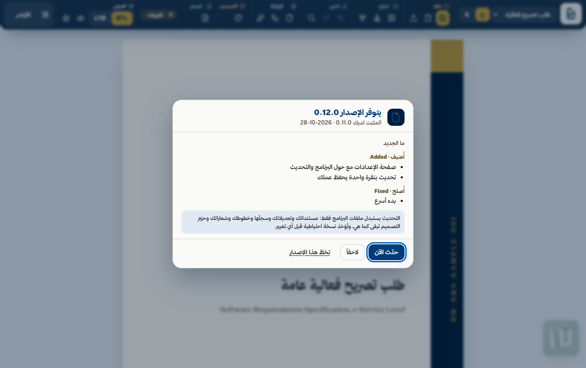

<div dir="rtl">

<h1 align="center"><picture><source media="(prefers-color-scheme: dark)" srcset="brand/logo/lockup-ar-dark.svg"></picture></h1>

<p align="center">عربي · الملف المقابل: <a href="README.md">README.md</a></p>

[](https://github.com/NJ-Burrito/Business-Wrap/actions/workflows/gates.yml)
[](.claude-plugin/plugin.json)
[](mcp/README.md)
[](bible/02-document-standard.ar.md)
[](LICENSE)

**يحوّل بزنس راب الأدلة عن خدمة إلكترونية (نموذج إجرائها، أو جولة في الخدمة الحية) إلى وثيقة متطلبات ثنائية اللغة: العربية من اليمين إلى اليسار والإنجليزية من اليسار إلى اليمين، تُحرَّر في محرر HTML محلي هو نفسه تخطيط الطباعة، وتُصدَّر إلى PDF وDOCX وملف تعديلات. وخلف كل قاعدة فحص.**


## ماذا يفعل

| المجال | ما تحصل عليه |
|---|---|
| **الحصاد** | طريقان للدخول ودمج بينهما: نموذج الإجراء (BPMN أو draw.io أو YAML) يعطي الأدوار وسير العمل والقواعد والحالات، ومسح الخدمة الحية يعطي البطاقة والنموذج والمرفقات والرسائل. الدمج يجمع الاثنين ولا يختار أحدهما. |
| **المحرر** | ملف HTML واحد يُفتح من الجهاز. الصفحة التي تحرّرها هي الصفحة التي تُطبع. كل كلمة مطبوعة وكل جدول وعنوان وخاصية تصميم قابلة للتعديل والتراجع ومسجّلة. |
| **الشريط** | أقسام معنونة (ملف · إدراج · تحرير · الوثيقة · التصميم · تصدير · العرض). حدّد شيئاً فتتقدّم أدواته **وتبقى** أثناء عملك في اللوحات والقوائم ومنتقيات الألوان، والنقر على مساحة فارغة أو Esc يعيد الأدوات العامة. |
| **البطاقات الشارحة** | توقّف لحظة على أي أداة (أو اصل إليها بلوحة المفاتيح): تظهر بطاقة باسمها واختصارها وجملة واحدة تشرح عملها مع حركة صغيرة توضّحه، بالعربية والإنجليزية. |
| **التخطيط** | التخطيط لا ينقلب أبداً. «ع» / «E» يغيّر اللغة والنسخة، وRTL / LTR يغيّر اتجاه الكلمات، ويبقى الشريط واللوحات والصفحة والعلامة في أماكنها. |
| **عرض الصفحات** | متصل، أو صفحة واحدة، أو كتاب (الغلاف وحده، ثم صفحتان متجاورتان باتجاه قراءة الوثيقة). يُحفظ اختيارك، ولا يمسّ الطباعة ولا التصدير. |
| **المخططات** | مخطط سير العمل قابل للتعديل على الصفحة: أشكال وأسهم بانحناءات ونصوص تُعدَّل في مكانها ومحاذاة وترتيب تلقائي وتكبير ومفتاح. واستيراد Mermaid وتصديره. |
| **التصميم** | لوحة تصميم بلغة واضحة: الألوان (مربع لون ورمز hex) والأحجام (منزلق ورقم ووحدة) وأجزاء القالب والعناوين المطبوعة وتنسيق الكتلة الواحدة وCSS متقدم. **أي خط**: خطوط المشروع، أو خطوط هذا الجهاز، أو ملف خط ترفعه. |
| **التصدير** | PDF وDOCX (الخطوط مضمّنة دائماً نصاً حقيقياً قابلاً للتحديد)، وملف التعديلات JSON، وحزمة التصميم، وحفظ HTML (المحرر بتعديلاتك). |
| **الأتمتة** | خطافات ويب عند الحفظ والتصدير، وخادم MCP بـ 12 أداة، وإضافة Claude Code، والأمر `npx business-wrap update` للبقاء على آخر إصدار. |
| **الأمان** | فحص أمني يُبقي محتوى العملاء وبيانات الدخول والمسارات المحلية خارج المستودع، والمسح لا يرسل طلباً حقيقياً إلا إذا طلبت ذلك مرتين. |

> قرار المالك 2026-10-28: كل خط تختاره يُضمَّن نصاً حقيقياً في PDF وDOCX، وترخيص الخط مسؤولية المستخدم.
> (النص الأصلي: "Owner decision 2026-10-28: every chosen font is embedded as real text in PDF and DOCX; the font's licence is the user's responsibility.")

## البدء السريع

<div dir="ltr">

```powershell
npm ci                 # Node 20+; Chrome or Edge drives the PDF
npm run sample         # builds out/sample/event-permit.editor.html
npm run serve          # http://127.0.0.1:4317/ - one-click PDF + DOCX
npm test               # every suite, one after another
```

</div>

وثائقك أنت:

<div dir="ltr">

```powershell
node engine/build-editor.mjs <doc.json | folder>... --out out/my.editor.html [--theme design/ours/theme.json] [--embed-fonts] [--ui ar|en]
node engine/export.mjs --doc <document.json> [--edits edits.json] [--locale ar|en] [--out dir]
```

</div>

عند فتح المحرر من الجهاز (file://) ينزّل زر «PDF + DOCX» ملف الوثيقة المعدّلة ويعرض أمر `export.mjs`، ومن خلال `npm run serve` يصدّر بنقرة واحدة. المحرر الجاهز هو `assets/editor/business-wrap.html`.

## التثبيت والتحديث

**إضافة Claude Code** (المهارة وخادم MCP معاً، وتحتاج صلاحية الوصول إلى هذا المستودع):

<div dir="ltr">

```
/plugin marketplace add NJ-Burrito/Business-Wrap
/plugin install business-wrap@business-wrap
```

</div>

ثم قل: **«ابنِ وثيقة المتطلبات لـ …»** أو **«افتحها في المحرر»**.

**خادم MCP وحده** (stdio محلي؛ Node 20+، وChrome أو Edge للـ PDF، و`uv` للـ DOCX):

<div dir="ltr">

```
claude mcp add business-wrap -- npx -y -p business-wrap@0.11.0 business-wrap-mcp
```

</div>

الأدوات: `build_editor` و`validate_edits` و`apply_edits` و`export_document` و`export_design_pack` و`check_fonts` و`harvest_model` و`harvest_crawl` و`harvest_merge` و`diagram_mermaid` و`check_update` و`apply_update`، والتفاصيل في `mcp/README.ar.md`.

## التحديثات

**من داخل المحرر** (0.11.0): افتح المحرر عبر الخادم المحلي بالأمر `npm run serve -- <editor.html>` (أو `node engine/serve.mjs <editor.html>`). عند الفتح يفحص وجود إصدار أحدث، مرة في اليوم على الأكثر ودون أن يعطّل شيئاً. وإن وُجد ظهرت نافذة فيها رقم الإصدار وما الجديد فيه، مع **حدّث الآن** و**لاحقاً** و**تخطَّ هذا الإصدار**. «حدّث الآن» ينزّل الإصدار ويتحقق من بصمته، ويأخذ نسخة احتياطية، ويستبدل ملفات البرنامج فقط، ويتحقق من الإصدار الجديد، ثم يعيد تشغيل الخادم ويفتح مستندك حيث كنت. مستنداتك وتعديلاتك وسجلّها وحزم التصميم والخطوط والشعارات و`out/` و`.local/` لا تُمسّ أبداً، وأي فشل يعيد الإصدار السابق كما كان تماماً. و**الإعدادات** (قسم «العرض» في الشريط، أو Ctrl+K) تعرض معلومات البرنامج، وحالة التحديث مع **تحقّق الآن** ومفتاح الفحص التلقائي، وتفضيلاتك. وإن فُتح المحرر من ملف على الجهاز (`file://`) فالصفحة لا تستطيع الفحص، وتشرح الإعدادات طريقة التحديث.



**من الطرفية أو عبر وكيل:** يخبرك `npx business-wrap update --check` بصدور إصدار جديد (طلب واحد في اليوم على الأكثر)، ويثبّته `npx business-wrap update --apply --yes`، ويعرض `--notes` ما تغيّر وملاحظات الترحيل. لا يُحدَّث شيء دون موافقتك. المستودع خاص: يستخدم الفحص تسجيل دخولك `gh auth` على هذا الجهاز، والصفحة لا تحمل أي رمز دخول. التفاصيل في `bible/07-updates.ar.md`.

## ابدأ وثيقة (الحصاد)

> **المسح لا يرسل طلباً إلا إذا طلبت.** المسح تجربة جافة: يقرأ كل خطوة ويتوقف قبل الإجراء الأخير («إرسال»، «تقديم»، «تأكيد»، «دفع»؛ Send وSubmit وConfirm وPay). الإرسال الحقيقي يحتاج `submit: true` في الإعداد **و** `--yes-file-real-request`.

<div dir="ltr">

```powershell
npm run harvest:model -- <process.bpmn | .drawio | .yaml>   # roles, workflow, rules, statuses
npm run harvest:crawl -- <crawl.json>                        # card, form, attachments, messages
npm run harvest:merge -- <harvest.json> <process.json>       # the union of both
```

</div>

كل واحد منها يعطي ملف الوثيقة بالعربية والإنجليزية ومحرراً. وفي المحرر: **وثيقة جديدة**. التفاصيل في `bible/08-harvest.ar.md`.

## المحرر


- **أدوات التحديد تبقى.** الكتلة أو خلية الجدول أو الشعار أو الصورة أو شكل المخطط أو السهم يضع قسمه الخاص في مقدمة الشريط، ويبقى أثناء استخدامك القوائم ولوحة التصميم ومنتقيات الألوان والمحررات المضمّنة. النقر على مساحة فارغة أو Esc يعيد الأدوات العامة.
- **أقسام تُطوى بالطريقة نفسها في اللغتين.** كل كلمة تحجز عرض الأطول بين صيغتيها العربية والإنجليزية، فيُظهر «ع» و«E» الأدوات نفسها في الأماكن نفسها.
- **«ع» / «E»** يبدّل لغة الواجهة والنسخة التي تحرّرها، و**RTL / LTR** يبدّل اتجاه الكلمات. انقر في أي مكان من الحقل، وينزلق المؤشر الذهبي إلى الاختيار الجديد.
- **الأوامر** (`Ctrl+K`): كل إجراء مع البحث. **وضع التركيز** (`F`) يخفي الأدوات، و**الوضع الهادئ** يوقف الحركة (ويعمل تلقائياً حين يطلب النظام تقليل الحركة).


**عرض الصفحات** (العرض ← الصفحات): *متصل* هو الورقة الطويلة، و*صفحة* يعرض صفحة واحدة كل مرة، و*كتاب* يبدأ بالغلاف وحده ثم يضع الصفحات أزواجاً باتجاه قراءة الوثيقة (في العربية: الصفحة الأولى من الزوج على اليمين). تقلّب الصفحات بـ Page Up / Page Down أو الأسهم أو العجلة أو شريط الصفحات، ويمكنك الكتابة في أي منها.

### المخططات
مخطط سير العمل نموذج لا صورة: انقر شكلاً لأدوات الشكل، أو سهماً لأدوات السهم، أو مساحة الرسم الفارغة لأدوات المخطط. اسحب للنقل، واسحب الزاوية لتغيير الحجم، واسحب جزءاً من السهم لثنيه، وانقر مرتين لتعديل النص في مكانه، وCtrl مع العجلة للتكبير. **استيراد Mermaid وتصديره** (`npm run diagram:mermaid` وأداة MCP `diagram_mermaid`). كل تغيير تعديل واحد مسجّل، فيصل إلى PDF وDOCX.

### التصميم والخطوط


الألوان حسب الدور (مربع لون ورمز hex)، والأحجام والتباعد (منزلق ورقم ووحدة، وتتحوّل القيمة عند تغيير الوحدة)، وأجزاء القالب (إظهار وإخفاء وترتيب)، والعناوين المطبوعة، وتنسيق الكتلة الواحدة (**نسّق هذا**)، وCSS متقدم بعد تنقيته. **الخطوط:** عائلات ثمانية للمشروع افتراضياً، أو أي خط مثبت على هذا الجهاز (يسأل المتصفح مرة واحدة)، أو ملف خط ترفعه. الخط المختار يصل دائماً إلى PDF وDOCX نصاً حقيقياً قابلاً للتحديد ومضمّناً.

### التصدير
| المخرج | الطريقة |
|---|---|
| PDF + DOCX | زر «PDF + DOCX» عبر `npm run serve`، أو `node engine/export.mjs` |
| ملف التعديلات JSON | «حفظ»: كل تغيير مع قيمته القديمة، وتراجعه في السجل |
| حزمة التصميم | لوحة التصميم ← تصدير التصميم (واستوردها في وثيقة أخرى) |
| حفظ HTML | المحرر بتعديلاتك في ملف واحد يُفتح في أي مكان |
| خطافات الويب | الوثيقة ← خطافات الويب: يُبلَّغ عنوانك عند الحفظ والتصدير (عبر `npm run serve`) |

## لوكلاء الذكاء الاصطناعي
Claude Code وClaude Desktop وCodex وCursor وGemini CLI وأي عميل MCP: اقرأ `AGENTS.md` و`SKILL.md`. في بداية أي مهمة على بزنس راب شغّل `npx business-wrap update --check` (أو أداة MCP `check_update`)، وأخبر المستخدم بالإصدار الأحدث في سطر واحد، ولا تحدّث أبداً دون موافقته.

### التعلّم المحلي
يحتفظ المحرّر بصمت بسجلّ لتعديلاتك وملاحظاتك وتصديراتك في `.local/learning/` على هذا الجهاز فقط (لا يدخل وثيقة ولا ملف تصدير ولا webhook، ولا يُرسل إلى أي مكان). يحوّل `npm run learn` التصحيحات المتكرّرة إلى قواعد (`.local/learning/rules.md` بالعربية والإنجليزية) يقرؤها مساعدك الذكي قبل مسوّدته التالية (أداة MCP ‏`learning_rules`). Ctrl+K ← «التعلّم المحلي» لإيقافه أو تصديره أو استيراده أو مسح كل ما تعلّمه. التفاصيل في `bible/10-learning.ar.md`.

## الفحص الأمني

<div dir="ltr">

```powershell
$env:PYTHONUTF8 = "1"
python security/check.py --all   # tree + history + commit messages: no client content, secrets or local paths
python design/build.py           # palette contrast gate + theme
git config core.hooksPath .githooks
```

</div>

## إعدادات الجهاز (لا تُرفع أبداً)
`.local/config.json` (مستثنى من git) أو متغيرات البيئة، والبيئة هي الأولى.

| المفتاح | متغير البيئة | الغرض |
|---|---|---|
| `fontDir` | `BW_FONT_DIR` | مجلد الخطوط (يُبحث فيه بعمق)، ويُفضَّل TrueType |
| `watermarkDir` | `BW_WATERMARK_DIR` | صور علامة الأداة، لواجهة المحرر فقط |
| `chrome` | `BW_CHROME` | ملف تشغيل Chrome أو Edge |
| `poppler` | `BW_POPPLER` | مجلد `bin` في poppler (pdftotext وpdffonts في الفحوص) |
| `brandDir` | `BW_BRAND_DIR` | مجلد شعار الأداة (الافتراضي `brand/logo/`)، للواجهة فقط |

المتصفحات المدعومة: Chrome وEdge، آخر إصدار مستقر (Chromium 120+).

## أين تجد الأشياء
| المجلد | يحتوي |
|---|---|
| `bible/` | المنهج بالعربية والإنجليزية، والعقود الآلية |
| `engine/` | المُخرِج، وعقد التعديلات، وبناء المحرر، وتصدير PDF وDOCX، والحصاد، وأوامر MCP |
| `editor/` | تطبيق المحرر: الهيكل والشريط والبطاقات الشارحة وعرض الصفحات والمخططات ولوحة التصميم والخطوط |
| `samples/event-permit/` | الخدمة النموذجية المجهّلة، بالعربية والإنجليزية |
| `tests/` | فحص لكل مجال، ويشغّلها كلها `npm test` |
| `design/`، `palette/`، `typography/` | حزم التصميم ورموز DTCG مع فحوصها |
| `fonts/` | قائمة الخطوط فقط (ملفات الخطوط لا تُرفع أبداً) |
| `security/` | الفحص الذي يُبقي محتوى العملاء والأسرار خارج المستودع |
| `docs/` | الدليل والبنية والقرارات وخارطة الطريق والخصوصية والمسرد ولقطات الشاشة |

خاص ومملوك: انظر `LICENSE`. لا يُرفع شيء: انظر `docs/privacy.ar.md`.

</div>
