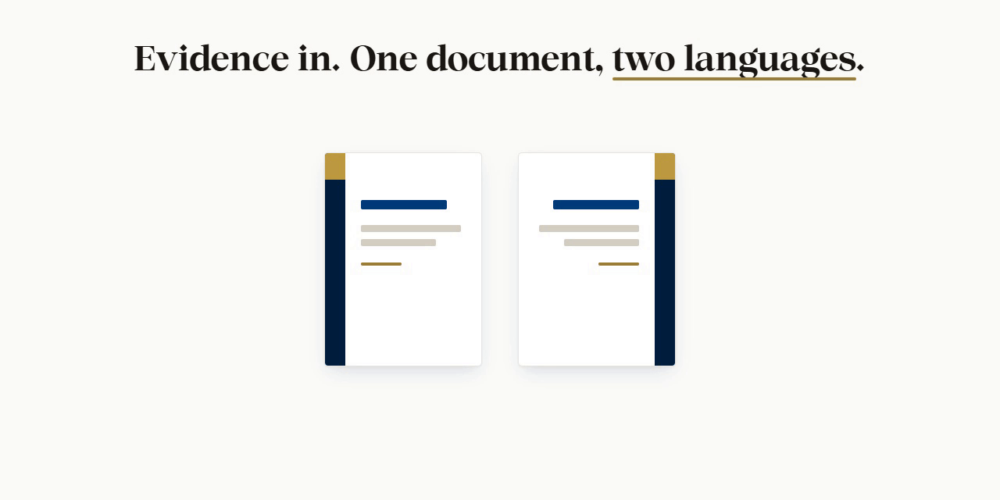

<div dir="rtl">

<h1 align="center">بزنس راب (Business-Wrap): مولّد وثائق متطلبات ثنائية اللغة (عربي وإنجليزي)</h1>

<p align="center"></p>

<p align="center">
  <a href="https://nj-burrito.github.io/Business-Wrap/?lang=ar"></a>
  <a href="https://github.com/NJ-Burrito/Business-Wrap/releases/latest"></a>
  <a href="https://www.npmjs.com/package/business-wrap"></a>
  <a href="https://github.com/NJ-Burrito/Business-Wrap/actions/workflows/gates.yml"></a>
  <a href="LICENSE"></a>
  <a href=".claude-plugin/marketplace.json"></a>
  <a href="mcp/server.json"></a>
  <a href="README.md"></a>
  <a href="https://github.com/NJ-Burrito/Business-Wrap/stargazers"></a>
</p>

## ⚡ في عشر ثوانٍ

📥 **الأدلة تدخل:** نموذج الإجراء (BPMN أو draw.io أو YAML) أو جولة في الخدمة الحية.

✍️ **التحرير على الصفحة التي تُطبع:** العربية من اليمين إلى اليسار، والإنجليزية من اليسار إلى اليمين.

📄 **المخرج:** PDF وDOCX، والخطوط مضمّنة نصاً حقيقياً قابلاً للتحديد.

🆓 مجاني ومفتوح المصدر (رخصة MIT). يعمل على جهازك. لا يُرفع شيء.

**انتقل إلى:** [▶️ البدء السريع](#️-البدء-السريع) · [✅ قبل أن تبدأ](#-قبل-أن-تبدأ) · [🧩 التثبيت](#-التثبيت) · [🚀 الأوامر](#-الأوامر) · [🔁 التحديثات](#-التحديثات) · [🧰 ماذا يفعل](#-ماذا-يفعل) · [🔤 الخطوط](#-الخطوط) · [🤖 لوكلاء الذكاء الاصطناعي](#-لوكلاء-الذكاء-الاصطناعي)

## ▶️ البدء السريع

📂 افتح طرفية في مجلد Business-Wrap: `cd Business-Wrap`

📦 ثبّت مرة واحدة: `npm ci`

▶️ شغّل الخادم المحلي: `npm run serve` (في المرة الأولى يبني محرر المثال)

🌐 افتح العنوان الذي يطبعه، http://127.0.0.1:4317/، في Chrome أو Edge.

⚠️ افتح المحرر دائماً **عبر الخادم المحلي**، لا بالنقر المزدوج على ملف HTML. التصدير والطباعة وقائمة الطابعات والتحديث تحتاج الخادم.

## ✅ قبل أن تبدأ

| تحتاج إلى | تحقّق منه | لماذا |
|---|---|---|
| 🟢 Node 20 أو أحدث | `node --version` | يشغّل كل شيء |
| 🐍 uv | `uv --version` | يشغّل خطوات Python (إنهاء PDF وبناء DOCX) مع حزمها، دون تثبيت بـ pip |
| 🌐 Chrome أو Edge | افتحه مرة | يطبع ملف PDF |
| 🌱 git | `git --version` | نسخ المستودع وسوق الإضافات |

📌 ليس لديك uv؟ ثبّته: https://docs.astral.sh/uv/getting-started/installation/ (ودونه يعود بزنس راب إلى `python` العادي ويخبرك بالحزم التي يحتاجها).

🧪 اختياري، للفحوص فقط: poppler (`pdffonts -v`).

## 🧩 التثبيت

🧩 **إضافة Claude Code** (المهارة وخادم MCP معاً):

<div dir="ltr">

```
/plugin marketplace add NJ-Burrito/Business-Wrap
/plugin install business-wrap@business-wrap
```

</div>

💬 ثم قل: **«ابنِ وثيقة متطلبات …»** أو **«افتحها في المحرر»**.

🔌 **خادم MCP وحده** (أي عميل MCP، stdio محلي؛ من npm):

<div dir="ltr">

```
claude mcp add business-wrap -- npx -y -p business-wrap@latest business-wrap-mcp
```

</div>

💻 **من المصدر:** `git clone https://github.com/NJ-Burrito/Business-Wrap` ثم [البدء السريع](#️-البدء-السريع).

<details>
<summary>📦 طرق أخرى: ملف الإصدار المضغوط، وخادم MCP من نسخة محلية، وقائمة الأدوات</summary>

- ملف الإصدار: `business-wrap-<version>.zip` مع `.sha256` من https://github.com/NJ-Burrito/Business-Wrap/releases/latest. وفي ذلك المجلد: `npm ci`.
- خادم MCP من نسخة محلية: `claude mcp add business-wrap -- node <path-to>/Business-Wrap/mcp/cli.mjs`
- خادم MCP من وسم GitHub (دون npm): `claude mcp add business-wrap -- npx -y -p github:NJ-Burrito/Business-Wrap#v0.11.1 business-wrap-mcp`
- الأدوات: `build_editor` و`validate_edits` و`apply_edits` و`export_document` و`export_design_pack` و`check_fonts` و`harvest_model` و`harvest_crawl` و`harvest_merge` و`diagram_mermaid` و`check_update` و`apply_update`، إضافة إلى أدوات `learning_*`. التفاصيل في `mcp/README.ar.md`.

</details>

## 🚀 الأوامر

<div dir="ltr">

```powershell
npm ci                 # install
npm run serve          # http://127.0.0.1:4317/ : builds the sample the first time; one-click PDF + DOCX
npm run sample         # rebuild out/sample/event-permit.editor.html
npm test               # every suite, one after another
```

</div>

<details>
<summary>📝 وثائقك أنت</summary>

<div dir="ltr">

```powershell
node engine/build-editor.mjs <doc.json | folder>... --out out/my.editor.html [--theme design/ours/theme.json] [--embed-fonts] [--ui ar|en]
node engine/export.mjs --doc <document.json> [--edits edits.json] [--locale ar|en] [--out dir]
```

</div>

عند فتح المحرر من الجهاز (file://) ينزّل زر «PDF + DOCX» ملف الوثيقة المعدّلة ويعرض أمر `export.mjs`، ومن خلال `npm run serve` يصدّر بنقرة واحدة. المحرر الجاهز هو `assets/editor/business-wrap.html`.

</details>

## 🔁 التحديثات

✨ **من داخل المحرر:** افتحه عبر `npm run serve`. الإصدار الأحدث يظهر في نافذة مع **حدّث الآن** و**لاحقاً** و**تخطَّ هذا الإصدار**.

🛡️ «حدّث الآن» يأخذ نسخة احتياطية أولاً، ويستبدل ملفات البرنامج فقط، ويعيد الإصدار السابق عند أي فشل.

🧩 **إضافة Claude Code:** `/plugin marketplace update business-wrap` ثم `/plugin update business-wrap`.

⌨️ **الطرفية أو الوكيل:** `node update/cli.mjs --check` (طلب واحد في اليوم على الأكثر)، و`--apply --yes` للتثبيت، و`--notes` لما تغيّر.

🔓 المستودع عام: لا رمز ولا تسجيل دخول. ولا يُحدَّث شيء دون موافقتك.

<details>
<summary>📖 كيف يعمل التحديث من داخل المحرر</summary>

عند الفتح (عبر `npm run serve -- <editor.html>` أو `node engine/serve.mjs <editor.html>`) يفحص المحرر وجود إصدار أحدث، مرة في اليوم على الأكثر ودون أن يعطّل شيئاً. «حدّث الآن» ينزّل الإصدار ويتحقق من بصمته، ويأخذ نسخة احتياطية، ويستبدل ملفات البرنامج فقط، ويتحقق من الإصدار الجديد، ثم يعيد تشغيل الخادم ويفتح مستندك حيث كنت. مستنداتك وتعديلاتك وسجلّها وحزم التصميم والخطوط والشعارات و`out/` و`.local/` لا تُمسّ أبداً. و**الإعدادات** (قسم «العرض» في الشريط، أو Ctrl+K) تعرض معلومات البرنامج، وحالة التحديث مع **تحقّق الآن** ومفتاح الفحص التلقائي، وتفضيلاتك. وإن فُتح المحرر من ملف على الجهاز (`file://`) فالصفحة لا تستطيع الفحص، وتشرح الإعدادات طريقة التحديث. كل الإصدارات: https://github.com/NJ-Burrito/Business-Wrap/releases. التفاصيل في `bible/07-updates.ar.md`.

</details>

## 🧰 ماذا يفعل

🌾 **الحصاد:** نموذج الإجراء يعطي الأدوار وسير العمل والقواعد والحالات، ومسح الخدمة الحية يعطي البطاقة والنموذج والمرفقات والرسائل. والدمج يجمع الاثنين.

📝 **المحرر:** ملف HTML واحد. الصفحة التي تحرّرها هي الصفحة التي تُطبع. وكل تغيير قابل للتراجع ومسجّل.

🔀 **لغتان وتخطيط واحد:** «ع» / «E» يبدّل اللغة، وRTL / LTR يبدّل اتجاه الكلمات. ولا يقفز شيء.

🧭 **المخططات:** مخطط سير العمل قابل للتعديل على الصفحة، مع استيراد Mermaid وتصديره.

🎨 **التصميم:** الألوان والأحجام وأجزاء القالب وأي خط، بلغة واضحة.

📤 **التصدير:** PDF وDOCX وملف التعديلات JSON وحزمة التصميم وحفظ HTML وخطافات الويب.

🔐 **الأمان:** فحص أمني يُبقي محتوى العملاء وبيانات الدخول والمسارات المحلية خارج المستودع.

<details>
<summary>🔍 جدول الميزات كاملاً</summary>

| المجال | ما تحصل عليه |
|---|---|
| **الحصاد** | طريقان للدخول ودمج بينهما: نموذج الإجراء (BPMN أو draw.io أو YAML) يعطي الأدوار وسير العمل والقواعد والحالات، ومسح الخدمة الحية يعطي البطاقة والنموذج والمرفقات والرسائل. الدمج يجمع الاثنين ولا يختار أحدهما. |
| **المحرر** | ملف HTML واحد يُفتح من الجهاز. الصفحة التي تحرّرها هي الصفحة التي تُطبع. كل كلمة مطبوعة وكل جدول وعنوان وخاصية تصميم قابلة للتعديل والتراجع ومسجّلة. |
| **الشريط** | أقسام معنونة (ملف · إدراج · تحرير · الوثيقة · التصميم · تصدير · العرض). حدّد شيئاً فتتقدّم أدواته **وتبقى** أثناء عملك في اللوحات والقوائم ومنتقيات الألوان، والنقر على مساحة فارغة أو Esc يعيد الأدوات العامة. |
| **البطاقات الشارحة** | توقّف لحظة على أي أداة (أو اصل إليها بلوحة المفاتيح): تظهر بطاقة باسمها واختصارها وجملة واحدة تشرح عملها مع حركة صغيرة توضّحه، بالعربية والإنجليزية. |
| **التخطيط** | التخطيط لا ينقلب أبداً. «ع» / «E» يغيّر اللغة والنسخة، وRTL / LTR يغيّر اتجاه الكلمات، ويبقى الشريط واللوحات والصفحة والعلامة في أماكنها. |
| **عرض الصفحات** | متصل، أو صفحة واحدة، أو كتاب (الغلاف وحده، ثم صفحتان متجاورتان باتجاه قراءة الوثيقة). يُحفظ اختيارك، ولا يمسّ الطباعة ولا التصدير. |
| **المخططات** | أشكال وأسهم بانحناءات ونصوص تُعدَّل في مكانها ومحاذاة وترتيب تلقائي وتكبير ومفتاح. واستيراد Mermaid وتصديره. |
| **التصميم** | الألوان (مربع لون ورمز hex) والأحجام (منزلق ورقم ووحدة) وأجزاء القالب والعناوين المطبوعة وتنسيق الكتلة الواحدة وCSS متقدم. **أي خط**: خطوط المشروع، أو خطوط هذا الجهاز، أو ملف خط ترفعه. |
| **التصدير** | PDF وDOCX (الخطوط مضمّنة دائماً نصاً حقيقياً قابلاً للتحديد)، وملف التعديلات JSON، وحزمة التصميم، وحفظ HTML (المحرر بتعديلاتك). |
| **الأتمتة** | خطافات ويب عند الحفظ والتصدير، وخادم MCP، وإضافة Claude Code، والأمر `node update/cli.mjs` للبقاء على آخر إصدار. |
| **الأمان** | فحص أمني يُبقي محتوى العملاء وبيانات الدخول والمسارات المحلية خارج المستودع، والمسح لا يرسل طلباً حقيقياً إلا إذا طلبت ذلك مرتين. |

قرار المالك 2026-10-28: كل خط تختاره يُضمَّن نصاً حقيقياً في PDF وDOCX، وترخيص الخط مسؤولية المستخدم.

</details>

<details>
<summary>🌾 ابدأ وثيقة (الحصاد)</summary>

> **المسح لا يرسل طلباً إلا إذا طلبت.** المسح تجربة جافة: يقرأ كل خطوة ويتوقف قبل الإجراء الأخير («إرسال»، «تقديم»، «تأكيد»، «دفع»؛ Send وSubmit وConfirm وPay). الإرسال الحقيقي يحتاج `submit: true` في الإعداد **و** `--yes-file-real-request`.

<div dir="ltr">

```powershell
npm run harvest:model -- <process.bpmn | .drawio | .yaml>   # roles, workflow, rules, statuses
npm run harvest:crawl -- <crawl.json>                        # card, form, attachments, messages
npm run harvest:merge -- <harvest.json> <process.json>       # the union of both
```

</div>

كل واحد منها يعطي ملف الوثيقة بالعربية والإنجليزية ومحرراً. وفي المحرر: **وثيقة جديدة**. التفاصيل في `bible/08-harvest.ar.md`.

</details>

<details>
<summary>📝 المحرر والمخططات والتصميم والتصدير</summary>

- **أدوات التحديد تبقى.** الكتلة أو خلية الجدول أو الشعار أو الصورة أو شكل المخطط أو السهم يضع قسمه الخاص في مقدمة الشريط، ويبقى أثناء استخدامك القوائم ولوحة التصميم ومنتقيات الألوان والمحررات المضمّنة. النقر على مساحة فارغة أو Esc يعيد الأدوات العامة.
- **أقسام تُطوى بالطريقة نفسها في اللغتين.** كل كلمة تحجز عرض الأطول بين صيغتيها العربية والإنجليزية، فيُظهر «ع» و«E» الأدوات نفسها في الأماكن نفسها.
- **«ع» / «E»** يبدّل لغة الواجهة والنسخة التي تحرّرها، و**RTL / LTR** يبدّل اتجاه الكلمات.
- **الأوامر** (`Ctrl+K`): كل إجراء مع البحث. **وضع التركيز** (`F`) يخفي الأدوات، و**الوضع الهادئ** يوقف الحركة (ويعمل تلقائياً حين يطلب النظام تقليل الحركة).

**عرض الصفحات** (العرض ← الصفحات): *متصل* هو الورقة الطويلة، و*صفحة* يعرض صفحة واحدة كل مرة، و*كتاب* يبدأ بالغلاف وحده ثم يضع الصفحات أزواجاً باتجاه قراءة الوثيقة (في العربية: الصفحة الأولى من الزوج على اليمين).

**المخططات:** انقر شكلاً لأدوات الشكل، أو سهماً لأدوات السهم، أو مساحة الرسم الفارغة لأدوات المخطط. اسحب للنقل، واسحب الزاوية لتغيير الحجم، واسحب جزءاً من السهم لثنيه، وانقر مرتين لتعديل النص، وCtrl مع العجلة للتكبير. **استيراد Mermaid وتصديره** (`npm run diagram:mermaid` وأداة MCP `diagram_mermaid`).

**التصميم:** الألوان حسب الدور، والأحجام والتباعد، وأجزاء القالب (إظهار وإخفاء وترتيب)، والعناوين المطبوعة، وتنسيق الكتلة الواحدة (**نسّق هذا**)، وCSS متقدم بعد تنقيته.

| المخرج | الطريقة |
|---|---|
| PDF + DOCX | زر «PDF + DOCX» عبر `npm run serve`، أو `node engine/export.mjs` |
| ملف التعديلات JSON | «حفظ»: كل تغيير مع قيمته القديمة، وتراجعه في السجل |
| حزمة التصميم | لوحة التصميم ← تصدير التصميم (واستوردها في وثيقة أخرى) |
| حفظ HTML | المحرر بتعديلاتك في ملف واحد يُفتح في أي مكان |
| خطافات الويب | الوثيقة ← خطافات الويب: يُبلَّغ عنوانك عند الحفظ والتصدير (عبر `npm run serve`) |

**التصدير والطباعة:** قائمة تصدير واحدة ومدخل طباعة واحد؛ PDF وDOCX لكل لغة أو للغتين، وHTML، وHTML للطباعة، والتعديلات، وحزمة التصميم، والمخططات بصيغ Mermaid وSVG وPNG؛ مع نطاق الصفحات وخيار الغلاف.

**حزم القوالب:** الخدمة الإلكترونية، والتجارة الإلكترونية، ومركز الاتصال، والموافقات، وSaaS، وIEEE 29148 العامة، إضافة إلى حزمتك (`templates/_example-custom`). كل متطلب يذكر دليله. التفاصيل في `bible/09-template-packs.ar.md`.

**التعلّم المحلي:** سجلّ لتعديلاتك في `.local/learning/` على هذا الجهاز فقط؛ ويحوّل `npm run learn` التصحيحات المتكرّرة إلى قواعد لمساعدك الذكي. الإعدادات ← «التعلّم المحلي» لإيقافه أو مسح كل ما تعلّمه. التفاصيل في `bible/10-learning.ar.md`.

</details>

## 🔤 الخطوط

🎯 الوثائق تستخدم عائلات ثمانية. **خط Cairo ممنوع**، ولا يُستخدم حتى بديلاً احتياطياً.

🏠 **نسختك أنت لها الأولوية:** `BW_FONT_DIR`، ثم `.local/config.json`، ثم مجلد خطوط النظام.

🎁 **لا نسخة على هذا الجهاز؟** تُستخدم نسخة احتياطية مضمّنة في `fonts/nj-fonts/`، فيُطبع PDF صحيحاً من أول مرة.

⚖️ المجلد `fonts/nj-fonts/` تحت رخصة ثمانية، **لا** رخصة MIT. التفاصيل في `fonts/README.ar.md`.

## 🤖 لوكلاء الذكاء الاصطناعي

📘 اقرأ `AGENTS.md` و`SKILL.md` (Claude Code وClaude Desktop وCodex وCursor وGemini CLI وأي عميل MCP).

🔔 في بداية أي مهمة شغّل `node update/cli.mjs --check` (أو أداة MCP `check_update`)، وأخبر المستخدم بالإصدار الأحدث في سطر واحد، ولا تحدّث أبداً دون موافقته.

<details>
<summary>⚙️ إعدادات الجهاز، والفحص الأمني، والمجلدات</summary>

**إعدادات الجهاز** (لا تُرفع أبداً): `.local/config.json` (مستثنى من git) أو متغيرات البيئة، والبيئة هي الأولى.

| المفتاح | متغير البيئة | الغرض |
|---|---|---|
| `fontDir` | `BW_FONT_DIR` | مجلد الخطوط (يُبحث فيه بعمق)، ويُفضَّل TrueType |
| `watermarkDir` | `BW_WATERMARK_DIR` | صور علامة الأداة، لواجهة المحرر فقط |
| `chrome` | `BW_CHROME` | ملف تشغيل Chrome أو Edge |
| `poppler` | `BW_POPPLER` | مجلد `bin` في poppler (pdftotext وpdffonts في الفحوص) |
| `brandDir` | `BW_BRAND_DIR` | مجلد شعار الأداة (الافتراضي `brand/logo/`)، للواجهة فقط |

المتصفحات المدعومة: Chrome وEdge، آخر إصدار مستقر (Chromium 120+).

**الفحص الأمني:**

<div dir="ltr">

```powershell
$env:PYTHONUTF8 = "1"
python security/check.py --all   # tree + history + commit messages: no client content, secrets or local paths
python design/build.py           # palette contrast gate + theme
git config core.hooksPath .githooks
```

</div>

| المجلد | يحتوي |
|---|---|
| `bible/` | المنهج بالعربية والإنجليزية، والعقود الآلية |
| `engine/` | المُخرِج، وعقد التعديلات، وبناء المحرر، وتصدير PDF وDOCX، والحصاد، وأوامر MCP |
| `editor/` | تطبيق المحرر: الهيكل والشريط والبطاقات الشارحة وعرض الصفحات والمخططات ولوحة التصميم والخطوط |
| `samples/event-permit/` | الخدمة النموذجية المجهّلة، بالعربية والإنجليزية |
| `tests/` | فحص لكل مجال، ويشغّلها كلها `npm test` |
| `design/`، `palette/`، `typography/` | حزم التصميم ورموز DTCG مع فحوصها |
| `fonts/` | قائمة الخطوط والنسخة الاحتياطية المضمّنة من ثمانية (`fonts/nj-fonts/`، بترخيصها الخاص) |
| `security/` | الفحص الذي يُبقي محتوى العملاء والأسرار خارج المستودع |
| `docs/` | الدليل والبنية والقرارات وخارطة الطريق والخصوصية والمسرد |

</details>

⚖️ رخصة MIT: انظر `LICENSE`. والمجلد `fonts/nj-fonts/` يبقى تحت رخصة ثمانية. 🔒 لا يُرفع شيء: انظر `docs/privacy.ar.md`.

## 🌐 المزيد من NJ
[الموقع الشخصي](https://nj-burrito.github.io/) · [NJ-Kit](https://nj-burrito.github.io/NJ-Kit/) · [QA-Wrap](https://nj-burrito.github.io/QA-Wrap/) · [Profile-Wrap](https://nj-burrito.github.io/Profile-Wrap/) · [Story-Wrap](https://nj-burrito.github.io/story-wrap/ar/) · [GitHub](https://github.com/NJ-Burrito)

</div>
