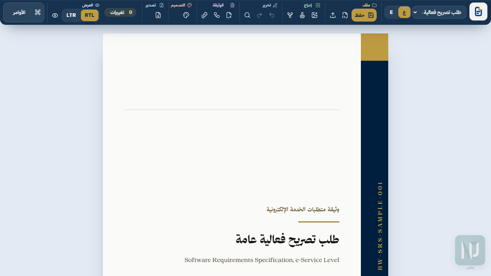
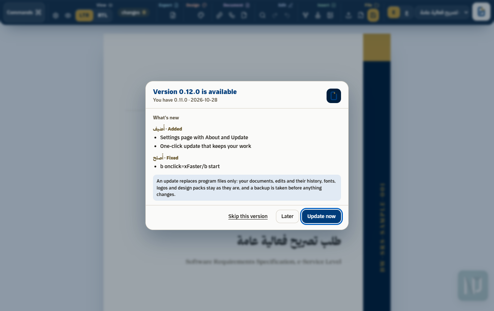
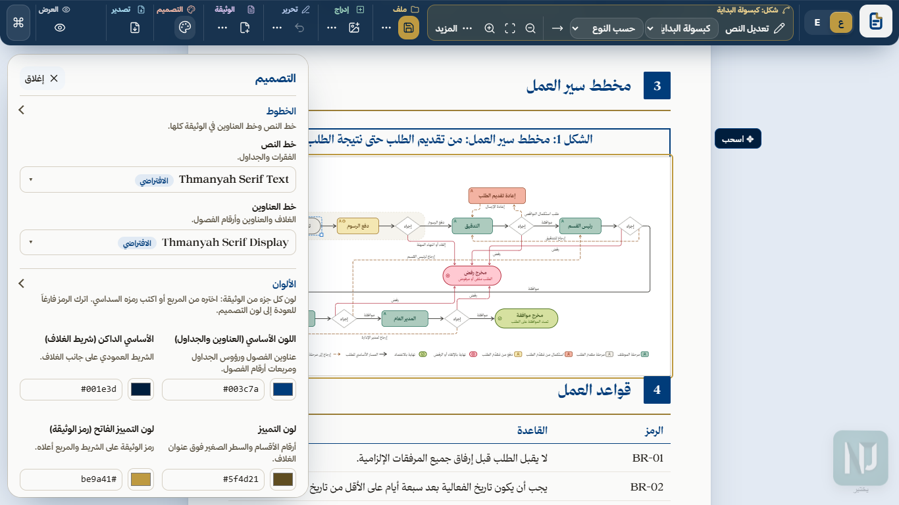
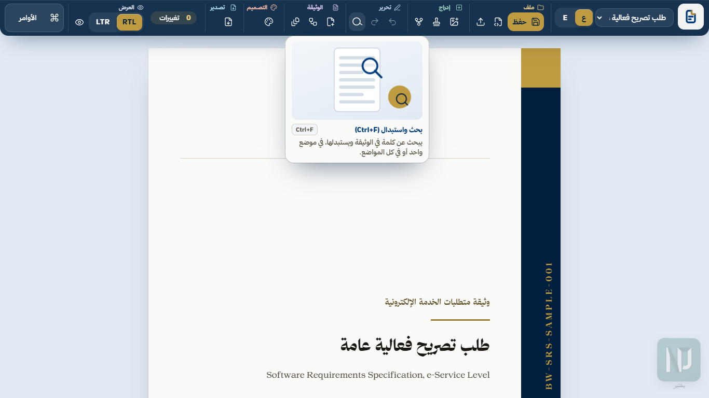
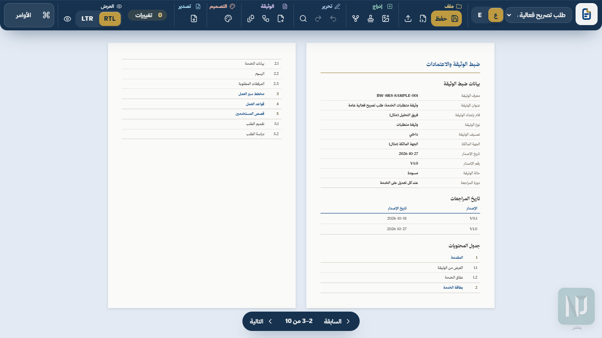
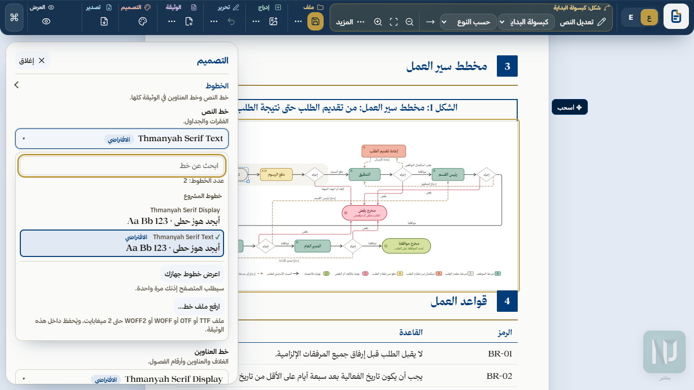

<h1 align="center"><picture><source media="(prefers-color-scheme: dark)" srcset="brand/logo/lockup-en-dark.svg"></picture></h1>

<p align="center">EN · pair: <a href="README.ar.md">README.ar.md</a></p>

[](https://github.com/NJ-Burrito/Business-Wrap/actions/workflows/gates.yml)
[](.claude-plugin/plugin.json)
[](mcp/README.md)
[](bible/02-document-standard.md)
[](LICENSE)

**Business-Wrap turns evidence about an e-service (its process model, or a walk through the live service) into a bilingual requirements document: Arabic right-to-left and English left-to-right, edited in a local HTML editor that *is* the print layout, and exported to PDF, DOCX and an edits file. Every rule has a gate.**



## What it does

| Area | What you get |
|---|---|
| **Harvest** | Two ways in, and a merge: a process model (BPMN, draw.io, YAML) gives roles, workflow, rules and statuses; a crawl of the live service gives the card, the form, attachments and messages. The merge keeps both, never picks. |
| **Editor** | One HTML file, opened from disk. The page you edit is the page that prints. Every printed word, table, label and design property is editable, undoable and recorded. |
| **Toolbar** | Labelled sections (File · Insert · Edit · Document · Design · Export · View). Select something and its own tools come first and **stay** while you work in panels, menus and pickers; a click on empty space or Esc brings the general tools back. |
| **Explainers** | Rest on any tool for a moment (or reach it with the keyboard): a card names it, shows its shortcut, says what it does in one sentence and plays a small animation of it. Arabic and English. |
| **Layout** | The layout never flips. «ع» / «E» changes the language and the edition; RTL / LTR changes the direction of the words. Toolbar, panels, page and watermark stay where they are. |
| **Page views** | Continuous, Single page, or Book (the cover alone, then two pages side by side in the document's reading direction). Remembered; print and export are untouched. |
| **Diagrams** | The workflow figure is editable on the page: shapes, arrows with bends, labels in place, alignment, auto layout, zoom, legend. Mermaid in and out. |
| **Design** | A plain-language Design panel: colours (swatch + hex), sizes (slider + number + unit), template parts, labels, per-block style, advanced CSS. **Any font**: the project's, this computer's or an uploaded file. |
| **Exports** | PDF and DOCX (fonts always embedded as real, selectable text), the edits JSON, a design pack, Save HTML (the editor with your edits). |
| **Automation** | Webhooks on save and export; an MCP server with 12 tools; a Claude Code plugin; `npx business-wrap update` to stay current. |
| **Safety** | A security gate keeps client content, credentials and local paths out of the repository; the crawler never files a real request unless you ask twice. |

> Owner decision 2026-10-28: every chosen font is embedded as real text in PDF and DOCX; the font's licence is the user's responsibility.

## Quick start

```powershell
npm ci                 # Node 20+; Chrome or Edge drives the PDF
npm run sample         # builds out/sample/event-permit.editor.html
npm run serve          # http://127.0.0.1:4317/ - one-click PDF + DOCX
npm test               # every suite, one after another
```

Your own documents:
```powershell
node engine/build-editor.mjs <doc.json | folder>... --out out/my.editor.html [--theme design/ours/theme.json] [--embed-fonts] [--ui ar|en]
node engine/export.mjs --doc <document.json> [--edits edits.json] [--locale ar|en] [--out dir]
```
Opened from disk (file://), «PDF + DOCX» downloads the edited document JSON and shows the `export.mjs` command; through `npm run serve` it exports in one click. The ready-made editor is `assets/editor/business-wrap.html`.

## Install and update

**Claude Code plugin** (skill + MCP server together; needs access to this repository):
```
/plugin marketplace add NJ-Burrito/Business-Wrap
/plugin install business-wrap@business-wrap
```
Then say **"build the requirements document for …"** or **"open it in the editor"**.

**MCP server only** (stdio, local; Node 20+, Chrome or Edge for the PDF, `uv` for the DOCX):
```
claude mcp add business-wrap -- npx -y -p business-wrap@0.11.0 business-wrap-mcp
```
Tools: `build_editor`, `validate_edits`, `apply_edits`, `export_document`, `export_design_pack`, `check_fonts`, `harvest_model`, `harvest_crawl`, `harvest_merge`, `diagram_mermaid`, `check_update`, `apply_update` — see `mcp/README.md`.

## Updates

**In the editor** (0.11.0): open the editor through the local server, `npm run serve -- <editor.html>` (or `node engine/serve.mjs <editor.html>`). At launch it checks for a newer release, at most once a day and without blocking anything. When one is out, a popup shows the version and what is new, with **Update now**, **Later** and **Skip this version**. Update now downloads the release, checks its fingerprint, backs up, replaces the program files only, verifies the new version, restarts the server and reopens your document where you were. Your documents, edits and their history, design packs, fonts, logos, `out/` and `.local/` are never touched, and any failure puts the previous version back exactly. **Settings** (toolbar View section, or Ctrl+K) shows About, the update state with **Check now** and the auto-check switch, and your preferences. Opened from disk (`file://`), the page cannot check: Settings says how to update.



**From a terminal or an agent:** `npx business-wrap update --check` tells you when a release is out (at most one request a day); `npx business-wrap update --apply --yes` installs it; `--notes` shows what changed and the migration notes. Nothing updates without your consent. The repository is private: the check uses your `gh auth` sign-in on this computer, and the page never holds a token. Details: `bible/07-updates.md`.

## Start a document (harvest)

> **The crawler never files a request unless you ask.** A crawl is a dry run: it reads every step and stops before the final action (Send, Submit, Confirm, Pay; «إرسال»، «تقديم»، «تأكيد»، «دفع»). Filing a real request needs `submit: true` in the config **and** `--yes-file-real-request`.

```powershell
npm run harvest:model -- <process.bpmn | .drawio | .yaml>   # roles, workflow, rules, statuses
npm run harvest:crawl -- <crawl.json>                        # card, form, attachments, messages
npm run harvest:merge -- <harvest.json> <process.json>       # the union of both
```
Each gives the Arabic and English document JSON and an editor. In the editor: **New document**. See `bible/08-harvest.md`.

## The editor



- **Sticky selection tools.** A block, a table cell, a logo, an image, a diagram shape or an arrow puts its own section first in the toolbar. It stays while you use menus, the Design panel, colour pickers or inline editors. A click on empty space, or Esc, returns the general tools.
- **Sections that fold the same way in both languages.** Every word keeps the width of the longer of its Arabic and English forms, so «ع» and «E» show the same tools in the same places.
- **«ع» / «E»** switch the interface language and the edition you edit; **RTL / LTR** switch the direction of the words. Click anywhere on either field; the gold thumb slides to the new choice.
- **Commands** (`Ctrl+K`): every action, searchable. **Focus mode** (`F`) hides the tools; **Calm mode** turns motion off (also on when the system asks for reduced motion).





**Page views** (View → Pages): *Continuous* is the long sheet; *Single* shows one page at a time; *Book* opens on the cover alone, then pairs pages in the document's reading direction (Arabic: first page of a pair on the right). Page Up / Page Down, the arrow keys, the wheel or the page pill turn pages, and you can type in any of them.

### Diagrams
The workflow figure is a model, not a picture: click a shape for shape tools, an arrow for arrow tools, the empty drawing for diagram tools. Drag to move, drag a corner to resize, drag an arrow's segment to bend it, double-click to edit a label in place, Ctrl + wheel to zoom. **Import / Export Mermaid** (`npm run diagram:mermaid`, MCP `diagram_mermaid`). Every change is one recorded edit, so it reaches the PDF and DOCX.

### Design and fonts



Colours by role (swatch + hex code), sizes and spacing (slider + number + unit, converted when the unit changes), template parts (show, hide, order), printed labels, one block's own style (**Style this**) and sanitised advanced CSS. **Fonts:** the project's Thmanyah families by default, any font installed on this computer (the browser asks once), or an uploaded font file. The chosen font always reaches the PDF and DOCX as real, selectable text, embedded.

### Exports
| Output | How |
|---|---|
| PDF + DOCX | «PDF + DOCX» through `npm run serve`, or `node engine/export.mjs` |
| Edits JSON | «Save»: every change, with its old value, reviewable in History |
| Design pack | Design panel → Export design (import it into another document) |
| Save HTML | the editor with your edits, one file, opens anywhere |
| Webhooks | Document → Webhooks: your URL is told on save and export (sent through `npm run serve`) |

## For AI agents
Claude Code, Claude Desktop, Codex, Cursor, Gemini CLI or any MCP client: read `AGENTS.md` and `SKILL.md`. At the start of a Business-Wrap task run `npx business-wrap update --check` (or MCP `check_update`); tell the user about a newer release in one line and never update without consent.

### Export & Print
- One Export menu and one Print entry in the toolbar, the same commands as the palette (one registry).
- PDF and DOCX per language or both, HTML, print HTML, edits, design pack, Mermaid / SVG / PNG of diagrams; page range and cover option; DOCX and print HTML need the local server.
- Every export is captured by Local learning (redacted, on this machine only).

### Template packs for any business
- One neutral service model; six packs: e-service, e-commerce, call-centre, approval, SaaS, generic IEEE 29148, plus your own (`templates/_example-custom`).
- An evidence stage and ledger: every requirement cites where it came from; organisation profiles set names and wording. See `bible/09-template-packs.md`.

### Local learning
The editor quietly keeps a journal of your edits, notes and exports in `.local/learning/` on this machine only (never in a document, an export or a webhook; never sent anywhere). `npm run learn` turns repeated corrections into rules (`.local/learning/rules.md`, Arabic + English) that your AI agent reads before its next draft (MCP `learning_rules`). Settings → "Local learning" (hidden: no toolbar button, no palette entry) to switch it off, export, import or forget everything. See `bible/10-learning.md`.

## Security gate
```powershell
$env:PYTHONUTF8 = "1"
python security/check.py --all   # tree + history + commit messages: no client content, secrets or local paths
python design/build.py           # palette contrast gate + theme
git config core.hooksPath .githooks
```

## Machine settings (never committed)
`.local/config.json` (gitignored) or environment variables; env wins.

| key | env | what |
|---|---|---|
| `fontDir` | `BW_FONT_DIR` | font root (searched recursively); TrueType preferred |
| `watermarkDir` | `BW_WATERMARK_DIR` | the tool's watermark images, editor UI only |
| `chrome` | `BW_CHROME` | Chrome or Edge executable |
| `poppler` | `BW_POPPLER` | poppler `bin` folder (pdftotext / pdffonts in the tests) |
| `brandDir` | `BW_BRAND_DIR` | the tool's logo folder (default `brand/logo/`), UI only |

Browser support: Chrome and Edge, latest stable (Chromium 120+).

## Where things are
| Folder | Holds |
|---|---|
| `bible/` | the method, AR + EN, and the machine contracts |
| `engine/` | renderer, edits contract, editor build, PDF/DOCX export, harvest, MCP-facing CLIs |
| `editor/` | the editor app: shell, toolbar, explainers, page views, diagrams, Design panel, fonts |
| `samples/event-permit/` | the anonymised sample service, AR + EN |
| `tests/` | one suite per area, all run by `npm test` |
| `design/`, `palette/`, `typography/` | design packs and DTCG tokens with their gates |
| `fonts/` | the font manifest only (font files are never committed) |
| `security/` | the gate that keeps client content and secrets out |
| `docs/` | guide, architecture, decisions, roadmap, privacy, glossary, screenshots |

Private and proprietary: see `LICENSE`. Nothing is uploaded: see `docs/privacy.md`.
