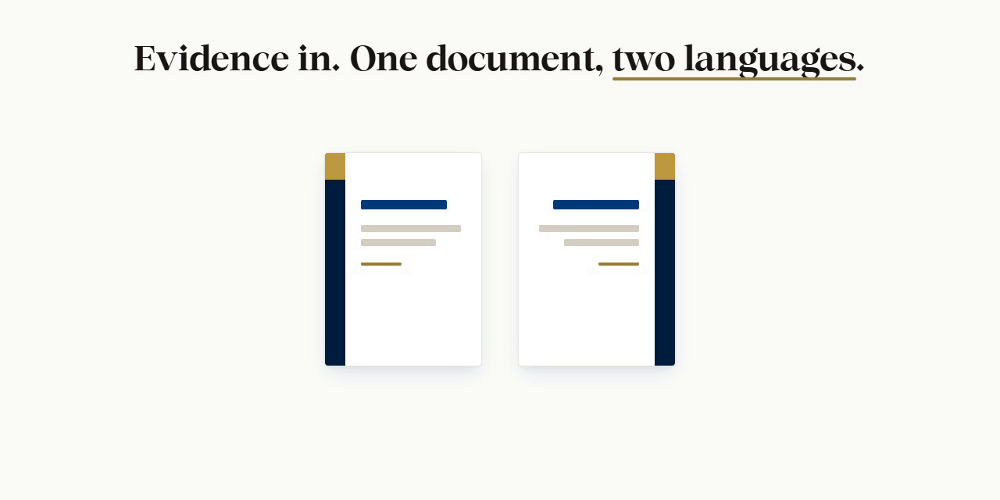
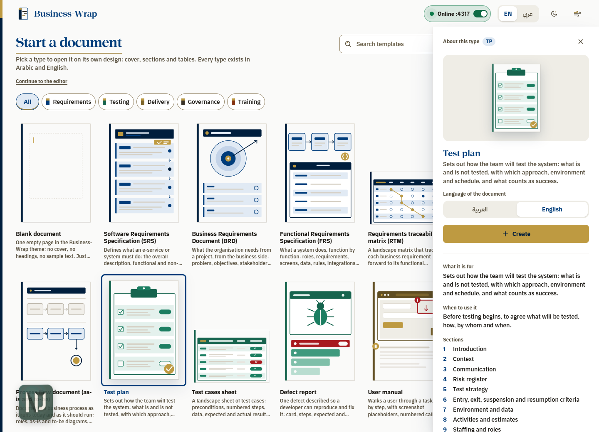

<h1 align="center">📄 Evidence in. Document out.</h1>

<h3 align="center">Business-Wrap: the bilingual document studio for business analysts and testers (Arabic + English)</h3>

<p align="center"></p>

<p align="center">
  <a href="https://nj-burrito.github.io/Business-Wrap/"></a>
  <a href="https://github.com/NJ-Burrito/Business-Wrap/releases/latest"></a>
  <a href="https://www.npmjs.com/package/business-wrap"></a>
  <a href="https://github.com/NJ-Burrito/Business-Wrap/blob/main/LICENSE"></a>
  <a href="https://github.com/NJ-Burrito/Business-Wrap/blob/main/.claude-plugin/marketplace.json"></a>
  <a href="https://github.com/NJ-Burrito/Business-Wrap/blob/main/mcp/server.json"></a>
  <a href="https://github.com/NJ-Burrito/Business-Wrap/blob/main/README.ar.md"></a>
  <a href="https://github.com/NJ-Burrito/Business-Wrap/stargazers"></a>
</p>

**Jump to:** [🧐 What is it?](#-what-is-it) · [📑 The document studio](#-the-document-studio) · [🚀 Start in 3 steps](#-start-in-3-steps) · [✅ Before you start](#-before-you-start) · [🔒 Is it safe?](#-is-it-safe) · [❓ Questions](#-questions) · [🆘 Problems?](#-problems) · [💻 For developers](#-for-developers--للمطورين)

## 🧐 What is it?

📄 Business-Wrap writes the documents a business analyst or a tester hands to a client or to another department: a requirements specification, a test plan, a user manual, release notes, minutes and more. **17 document types**, each with its own designed layout.

🌍 One document, two languages: Arabic and English.

✍️ You edit on the page that prints. What you see is what comes out.

🏠 It runs on your computer. Nothing is uploaded.

🆓 Free and open source (MIT).

## 📑 The document studio

🏁 However you open Business-Wrap (the desktop shortcut, the local host, or a `business-wrap:` link), the **start page** is the first screen; opening a specific document still opens that document. It is a gallery of the 17 types, each drawn as a small page, with a search box, category chips and your recent documents beside it.

🔌 The bar at the top carries the **local host switch**: a dot (green or red), the words «Online :4317» or «Offline», and a switch. It is the same control, with the same state, as the one in the editor's top bar, so you can start or stop the local host without leaving the start page. Stopping it saves your documents first and stops only the host.

<p align="center"></p>

🖱️ **Click a type and a side panel opens** beside the gallery. It shows a small thumbnail of the type that plays once (the Calm button shows a still frame instead), what the type is for, when to use it, its sections, who uses it, a language switch and **Create**. Esc or the close button shuts the panel. A double click (or Ctrl+Enter) creates the document at once. The editor opens on that type's own design: its first page, sections and tables, not a renamed SRS.

### 📄 The first page of each type

Every type opens with a first page built for its purpose. The thumbnail on the start page is only a picture for choosing a type. **Page 1 of the document never carries it**, or any other drawing, in the editor, in PDF or in Word. It uses straight lines, boxes and text. Word gets the same pages as the PDF.

| Family | What page 1 is | Types |
|---|---|---|
| **Title page** | Type code, title and subtitle, and nothing else: no table. The document control data (document ID, version, status, issue date, owner, prepared by, approved by, classification) and the type's own fields live in «Document control and approvals» on page 2, with the revision history and the approvals grid; then the contents (chapters only), and chapter 1 starts on a new page. | SRS, BRD, FRS, process flow, test plan, user manual, ToR, TOT |
| **Form** | A header at the top of the page (code chip, title, an ID box or a version badge), and the body continues on the same page. No contents list; the form's fields, document control and revisions are in the control section at the back. | defect report, change request, minutes, UAT sign-off, release notes |
| **Sheet** | A landscape page: a strip of status tiles, then the table itself; the fields are in the control section. Later pages repeat a short running header and the table's header row. | RTM, test cases |
| **Decision paper** | A band with the title, four key-figure tiles and a decision box with empty choices; the document ID sits in the foot. Page 2 holds control (with the type's fields) and approvals. | business case |
| **Blank** | One empty page. No cover, no control table, no heading, no sample text. | blank |

📚 Each type follows the outline of a named practice: the SRS follows the software requirements specification outline of ISO/IEC/IEEE 29148; the test plan, test cases, defect report and UAT sign-off follow ISO/IEC/IEEE 29119-3; the BRD, FRS, RTM and business case follow the BABOK Guide (IIBA); the process flow uses BPMN 2.0 notation and a SIPOC table; the rest follow common professional practice (ITIL 4 for the change request and release notes, PRINCE2 for the business case, ADDIE and Kirkpatrick for the TOT guide). They are starting structures written in Business-Wrap's own words, not certified templates and not a claim of compliance.

### 📚 The 17 types

| Type | بالعربية | Category | What it is for | Page 1 | `id` |
|---|---|---|---|---|---|
| Blank document | وثيقة فارغة | Start | One empty page in the Business-Wrap theme, to write on. | One empty page: no cover, no heading, no sample text. | `blank` |
| Software Requirements Specification (SRS) | وثيقة متطلبات البرمجيات (SRS) | Requirements | What an e-service or system must do: overall description, functional and non-functional requirements, workflow, user stories with acceptance criteria and how each is verified. | Title page: system or service, service code. | `srs` |
| Business Requirements Document (BRD) | وثيقة متطلبات العمل (BRD) | Requirements | What the organisation needs from a project: problem, objectives, stakeholders, success criteria. | Title page: business owner, sponsor, project. | `brd` |
| Functional Requirements Specification (FRS) | مواصفات المتطلبات الوظيفية (FRS) | Requirements | What a system does, function by function, traced back to the BRD. | Title page: system, module, related BRD. | `frs` |
| Requirements traceability matrix (RTM) | مصفوفة تتبع المتطلبات (RTM) | Requirements | A landscape matrix from each requirement to its design, test cases, results, defects and release. | Landscape sheet: six fields, five status tiles, then the matrix. | `rtm` |
| Process flow document (as-is and to-be) | وثيقة سير العملية (الحالي والمستهدف) | Requirements | A process as it runs today and as it should run: roles, two diagrams, pain points, gaps, metrics. | Title page: process owner, scope, level. | `process-flow` |
| Test plan | خطة الاختبار | Testing | How the team will test: what is and is not tested, approach, environment, schedule and what counts as success. | Title page: system under test, release, plan type, test window. | `test-plan` |
| Test cases sheet | جدول حالات الاختبار | Testing | A landscape sheet of cases with preconditions, steps, expected and actual result and status, plus a defect log. | Landscape sheet: six fields, six result tiles, then the cases. | `test-cases` |
| Defect report | تقرير عيب | Testing | One defect, described so a developer can reproduce and fix it. | Form: defect ID box, severity, priority and status chips, then the summary. | `defect-report` |
| User manual | دليل المستخدم | Delivery | A task, step by step, with screenshot placeholders, numbered callouts and reference tables. | Title page: system or service, system version, document language, target users. | `user-manual` |
| UAT sign-off | محضر قبول المستخدم (UAT) | Delivery | Scenarios and results, open defects, then a decision (accepted, with conditions or not accepted) and signatures. | Form: six fields, the acceptance statement with three empty choice boxes, then the decision and signatures. | `uat-signoff` |
| Release notes | ملاحظات الإصدار | Delivery | What is new, fixed and known, breaking changes and upgrade steps, in the user's words. | Form: version badge, four fields, then the highlights. | `release-notes` |
| Terms of Reference (ToR) | الشروط المرجعية (ToR) | Governance | Scope, deliverables, timeline, responsibilities and evaluation criteria for a call for proposals or a contract. | Title page: issuing organisation, reference number, proposals due. | `tor` |
| Change request with impact analysis | طلب تغيير مع تحليل الأثر | Governance | The reason, impact and risk over six areas, effort and cost, alternatives, the back-out plan, then the change authority's decision. | Form: request number box, eight fields, then the description and reason. | `change-request` |
| Minutes of meeting | محضر اجتماع | Governance | Attendance, agenda, decisions and actions with owners and due dates. | Form: meeting number box, six fields, then attendance. | `minutes` |
| Business case | دراسة الجدوى (حالة العمل) | Governance | Problem, benefits, options compared, recommendation, cost, risks and the decision requested. | Decision paper: band, four key-figure tiles, a decision box (approve, defer, reject). | `business-case` |
| Training of Trainers (TOT) guide | دليل تدريب المدربين (TOT) | Training | Objectives, modules, sessions, exercises, assessment and a day-by-day schedule. | Title page: duration, sessions, participants, delivery mode, certificate. | `tot` |

### ➕ Three ways to start one

1️⃣ **The start page.** Pick a tile, read the side panel and press Create. Search with `/`, or filter with the category chips. The language switch in the panel chooses which edition opens first; the other edition is kept in step.

2️⃣ **Inside the editor.** Press **Home** at the start of the top bar, or File tab, then **Start page** (Ctrl+Alt+N). Your work is saved first and your open document stays open behind it.

3️⃣ **The command line.** `npx business-wrap types` lists the types. `npx business-wrap new --type brd --title "Payments platform"` creates one and opens it. In Claude Code: `/business-wrap:new --type brd`.

### 🧰 What every type keeps

📤 **PDF and DOCX in both languages,** with the fonts embedded as real text.

🎀 **The whole editor:** the ribbon, editable diagrams, your profile and work log, the watermark and the tools that explain themselves.

🎨 **The Business-Wrap theme,** with a colour for each category and a first page built for the document's purpose (a title page, a form, a landscape sheet or a decision paper), never a decorative drawing.

🧾 **Starter text, not client data.** Every type opens with placeholder content you replace. Nothing in it comes from a real client.

## 🎁 What you get

📥 **You give it:** a type from the start page, or evidence for a requirements document: a process model (a file that draws the steps of the work: BPMN, draw.io or YAML) or a walk through the live service.

📄 **You get:** PDF and DOCX (Word) files. The fonts are inside, as real text you can select.

✍️ Arabic runs right to left. English runs left to right.

🎀 A ribbon with 12 tabs, a help panel for every tool, spell checking in Arabic and English with no internet, and a dim navy dark mode.

📦 Export and import a whole project.

🤖 Optional: your AI assistant can work in the open editor. It reads, edits as one undoable step, proofreads and draws a diagram.

## 🚀 Start in 3 steps

1️⃣ **Get the folder.** Download `business-wrap-<version>.zip` from the [releases page](https://github.com/NJ-Burrito/Business-Wrap/releases/latest) and unzip it. Or clone it: `git clone https://github.com/NJ-Burrito/Business-Wrap`, then `cd Business-Wrap`. Open a terminal (a window where you type commands) in that folder.

2️⃣ **Install once:** `npm ci` (a copy without `node_modules`, such as a zip, cannot export PDF or DOCX until this runs. The editor says so and offers «Install now»; the host also prints one line at start.)

3️⃣ **Start it:** `npm run serve` (the first time it builds the sample editor). Open the address it prints, `http://127.0.0.1:4317/`, in Google Chrome. Then pick a document type on the [start page](#-the-document-studio).

⚠️ Always open the editor **through the local server** (the `npm run serve` window), not by double-clicking the HTML file. Export, print, the printers list and updates need the server.

✅ Check the list below first.

## ✅ Before you start

| You need | Check it | Why |
|---|---|---|
| 🟢 Node 20 or newer | `node --version` | runs everything |
| 🐍 uv | `uv --version` | runs the Python steps (PDF finishing, DOCX) with their packages; no pip installs |
| 🌐 Google Chrome | open it once | prints the PDF |
| 🌱 git | `git --version` | cloning the repo and the plugin marketplace |

📌 No uv? Install it: https://docs.astral.sh/uv/getting-started/installation/ (without it Business-Wrap falls back to plain `python` and tells you which packages it needs).

🧪 Optional, tests only: poppler (`pdffonts -v`).

## 🧰 What it does

🌾 **Harvest (collect the facts):** a process model gives roles, workflow, rules and statuses. A crawl (an automatic walk) of the live service gives the card, form, attachments and messages. The merge keeps both.

🎧 **Sources:** add a meeting recording, a document, a web page, an image, an Android app or a tool folder on the start page. Each one runs in stages you can pause and review: a speaker-labelled transcript made on your own machine (Arabic dialects and English mixed in; on an NVIDIA GPU, 10 minutes of a meeting in about one; voices on one microphone kept apart), the text of an image or a screen-recording frame read by local OCR (Arabic and English), then candidate facts you accept, reject or edit. See [the guide](docs/guide.md#9-sources-from-a-meeting-a-document-or-a-site-to-checked-facts-0200).

📝 **Editor:** one HTML file. The page you edit is the page that prints. Every change is undoable and recorded.

🎀 **Ribbon:** 12 tabs (File, Export, Home, Font, Paragraph, Insert, Layout, Header and footer, Design, Review, Spelling, View), plus 4 that appear when you select a table, a picture or a diagram. Every tool has its name under it. Nothing scrolls sideways.

💡 **Help panel:** rest on a tool for a moment and a panel shows a small drawing of what it does. It floats over the pages and moves nothing.

🔤 **Spelling:** offline Arabic and English checking with one switch, a Spelling tab and a side panel with suggestions.

📦 **Projects:** export every document of a project as HTML, PDF, DOCX or edits, in one folder or one zip with an index page. Import a project, a folder, a zip or a pile of PDF, DOCX and HTML files.

🔍 **Zoom:** 25% to 400%, with Fill width, Fill height and Ctrl plus the mouse wheel. 100% is true size.

🌙 **Look:** a dim navy dark mode, a light mode whose cards, panels and fields have clear edges, a calm drafting-grid background behind the pages, and a watermark that reacts now and then without a sound.

🔀 **Two languages, one layout:** «ع» / «E» switches language; RTL / LTR switches word direction, in the editor and on the start page. The toolbar, the start page and the page stay where they are.

🧭 **Diagrams:** the workflow figure is editable on the page. Mermaid (a text language for diagrams) in and out.

🎨 **Design:** colours, sizes, template parts, any font. Labels say what they do, in Arabic and English.

📤 **Exports:** PDF, DOCX, edits JSON, design pack, Save HTML, webhooks (a message sent to an address you set).

🔌 **Server switch:** one toggle in the top bar. Turn the server off and the editor stays open with a Turn on card.

🗂️ **File and folder icons (Windows):** in Settings, use Business-Wrap icons for your PDF, Word and web page files. Restore puts the Windows icons back.

🔐 **Safety:** a security gate keeps client content, credentials and local paths out of the repo.

## 🔁 Updates

✨ **In the editor:** open it through `npm run serve`. A newer release shows a popup with **Update now**, **Later** and **Skip this version**.

🛡️ Update now backs up first, replaces program files only, and puts the old version back on any failure.

🔓 The repo is public: no token, no sign-in. Nothing updates without your consent.

💻 Plugin and terminal updates: see [For developers](#-for-developers--للمطورين).

## 🔤 Fonts

🎯 Documents use the Thmanyah families. **Cairo is banned**, also as a fallback.

🏠 **Your own copy wins:** `BW_FONT_DIR`, `.local/config.json`, then the system font folder.

🎁 **No copy on this machine?** A bundled fallback in `fonts/nj-fonts/` is used, so the PDF prints right out of the box.

⚖️ `fonts/nj-fonts/` is under the Thmanyah licence, **not** MIT. Details: [fonts/README.md](fonts/README.md).

## 🔒 Is it safe?

🏠 **Local only:** the editor, the PDF printer and the DOCX builder run on your computer. Nothing is uploaded ([docs/privacy.md](docs/privacy.md)).

🔁 **One automatic request:** the update check, at most once a day, to the public GitHub release list. Webhooks send only to an address you set.

🌾 **The crawler is a dry run:** it stops before Send, Submit, Confirm or Pay unless you ask twice.

🔏 **Tamper-evident history:** every edit, save and export is logged in a signed chain. Honest limit: it is not access control. Details are in [For developers](#-for-developers--للمطورين).

🛡️ **A security gate** (`security/check.py`, plus gitleaks in CI) keeps client content, credentials and local paths out of the repo. Found a problem? [SECURITY.md](SECURITY.md).

## ❓ Questions

<details>
<summary>📑 Which documents can I make?</summary>

17 types: blank, SRS, BRD, FRS, RTM, process flow, test plan, test cases, defect report, user manual, UAT sign-off, release notes, ToR, change request, minutes, business case and a TOT guide. See [the table](#-the-17-types). Each exports PDF and DOCX in Arabic and English.

</details>

<details>
<summary>🆓 Is it free?</summary>

Yes. MIT licence, no paid plan, no account.

</details>

<details>
<summary>🏠 Does my document leave my computer?</summary>

No. The editor, the PDF printer and the DOCX builder run locally.

The one automatic request is the update check: at most once a day, to the public GitHub release list. Webhooks send only to an address you set.

</details>

<details>
<summary>🤖 Do I need Claude?</summary>

No. The editor and the command line work on their own. The plugin and the MCP server are optional.

</details>

<details>
<summary>🔄 What goes in, what comes out?</summary>

In: a process model (BPMN, draw.io, YAML) or a crawl of a live service.

Out: PDF, DOCX, the edits JSON, a design pack, and the editor saved as HTML.

</details>

<details>
<summary>🌾 Will the crawler file a real request?</summary>

Not unless you ask twice: `submit: true` in the config and `--yes-file-real-request`. Otherwise it stops before Send, Submit, Confirm or Pay.

</details>

<details>
<summary>🔤 Which fonts can I use?</summary>

Thmanyah by default: your own copy wins, and a bundled fallback (under the Thmanyah licence, not MIT) makes the PDF right out of the box. Any font on your computer, or a file you upload, also works; its licence is your responsibility.

</details>

<details>
<summary>💻 What does it run on?</summary>

Tested on Windows 11 with Node 24 and Chrome. It needs Node 20+, Google Chrome (or another Chromium browser), and Python with uv for DOCX. **Linux is not supported** (the package refuses to install there); macOS is untested.

</details>

## 🆘 Problems?

🆘 **[Support page](https://nj-burrito.github.io/Business-Wrap/support.html):** the common fixes.

📖 **[The guide](docs/guide.md):** install, quick start, troubleshooting, backup.

🐞 **[Open an issue](https://github.com/NJ-Burrito/Business-Wrap/issues/new/choose):** pick Bug or Feature; include the version (`node update/cli.mjs --check`).

🔒 **Security problem?** Report it privately: [SECURITY.md](SECURITY.md).

## 💻 For developers / للمطورين

📌 Everything below is for developers, AI agents and power users. You do not need it to start.

### 🧩 Install

🧩 **Claude Code plugin** (the skill, the MCP server and the `/business-wrap:` commands together; they run from the plugin's own files with Node, no npm install and no registry):
```
/plugin marketplace add NJ-Burrito/Business-Wrap
/plugin install business-wrap@business-wrap
```
💬 Then say **"build the requirements document for …"** or **"open it in the editor"**.

🔌 **MCP server only** (any MCP client, stdio, local; 0.22.0 from the GitHub tag; npm still serves 0.12.0):
```
claude mcp add business-wrap -- npx -y -p github:NJ-Burrito/Business-Wrap#v0.22.0 business-wrap-mcp
```

💻 **From source:** `git clone https://github.com/NJ-Burrito/Business-Wrap`, then the [Start in 3 steps](#-start-in-3-steps).

<details>
<summary>📦 Other ways: release zip, MCP from a clone, tool list</summary>

- Release zip: `business-wrap-<version>.zip` + `.sha256` from https://github.com/NJ-Burrito/Business-Wrap/releases/latest. In that folder: `npm ci`.
- MCP from a clone: `claude mcp add business-wrap -- node <path-to>/Business-Wrap/mcp/cli.mjs` (no `npm ci` needed)
- Core tools (15): `build_editor`, `validate_edits`, `apply_edits`, `export_document`, `export_design_pack`, `check_fonts`, `harvest_model`, `harvest_crawl`, `harvest_merge`, `harvest_sources`, `open_in_editor`, `close_editor`, `diagram_mermaid`, `check_update`, `apply_update`, plus the `learning_*` tools and the `sources_*` tools (the Claude pass of the Sources tab). The live editor tools (`editor_list_documents`, `editor_get`, `editor_outline`, `editor_ops`, `editor_action`, `editor_new`, `editor_import`) and `host_health` need an open editor tab. A harvest tool given `open: true` opens its result in the editor. See [mcp/README.md](mcp/README.md).

</details>

### 🚀 Commands

```powershell
npm ci                 # install
npm run serve          # http://127.0.0.1:4317/ : builds the sample the first time; one-click PDF + DOCX
npm run sample         # rebuild out/sample/event-permit.editor.html
npm test               # every suite, one after another
```

<details>
<summary>📝 Your own documents</summary>

```powershell
node engine/build-editor.mjs <doc.json | folder>... --out out/my.editor.html [--theme design/ours/theme.json] [--embed-fonts] [--ui ar|en]
node engine/export.mjs --doc <document.json> [--edits edits.json] [--locale ar|en] [--out dir]
```
Opened from disk (file://), «PDF + DOCX» downloads the edited document JSON and shows the `export.mjs` command; through `npm run serve` it exports in one click. The ready-made editor is `assets/editor/business-wrap.html`.

</details>

<details>
<summary>⌨️ "/" commands in Claude Code (0.15.2)</summary>


Installed as a plugin, Business-Wrap adds these commands; type `/` in Claude Code to see them. Each runs `engine/cli.mjs` (the same `business-wrap <verb>` you can run yourself, with no AI and no network) and says in one line what it did.

| Command | What it does |
|---|---|
| `/business-wrap:open [doc.json\|folder\|editor.html]` | Start the local host and open the editor in your browser, Google Chrome first (a blank document when no file is given) |
| `/business-wrap:close` | Stop every host and close every browser window this install started |
| `/business-wrap:status` | Version, running hosts, how many steps were healed, any MCP problem |
| `/business-wrap:doctor` | What is installed, where state lives, the last MCP server starts, and whether a plugin update left the server on the previous version |
| `/business-wrap:new ["Title"]` | A new blank document pair (Arabic + English), opened in the editor |
| `/business-wrap:harvest <url\|crawl.json\|model\|PDF/DOCX/HTML\|folder>` | Harvest a live site (never submits), a process model or a document, then open it |
| `/business-wrap:import <file\|folder ...>` | Your own sources (BPMN, draw.io, YAML, PDF, DOCX, HTML) into documents |
| `/business-wrap:build <doc.json\|folder> --out <editor.html>` | Build the editor file |
| `/business-wrap:export <doc.json> [ar\|en]` | PDF + DOCX, then the render and export gates |
| `/business-wrap:verify-history <file>` | Check the tamper-evident history |
| `/business-wrap:report <from> <to>` | Work report for a date range |
| `/business-wrap:reset --dry-run` | List every library, browser profile and plugin-data folder this program keeps; with `--yes` (only after you agree) send them to the Recycle Bin so an old library cannot come back (`--all`: whole workspaces too) |
| `/business-wrap:update [--check\|--notes\|--apply --yes]` | Check, read what is new, or install (only after you agree) |
| `/business-wrap:tabs [project]` | The documents open in the live editor and the host health (needs the editor open) |
| `/business-wrap:outline [doc-id] [ar\|en]` | The outline of the open document: chapters, sections, blocks |
| `/business-wrap:edit <instruction>` | Change the open document as ONE undoable batch signed as the agent; keeps the Arabic and English editions in step; Ctrl+Z undoes it all |
| `/business-wrap:proofread [ar\|en\|both] [--apply]` | Proofread the open document (hamza, taa marbuta, Latin punctuation, English typos, AR/EN mismatch); fixes only with `--apply` |
| `/business-wrap:check [doc-id]` | Run the editor's Check panel on the open document and summarise the problems |
| `/business-wrap:diagram <description>` | Draft a diagram, render it to PNG, insert it into the open document |
| `/business-wrap:explain <tool or feature>` | Explain an editor feature from the docs and where it is on the ribbon |
| `/business-wrap:action <name>` | Run one safe editor action: `check`, `renumber`, `saveHtml`, `exportPdf`, `share`, zoom, theme, reading mode, find, save, outline, next and previous page. Anything that deletes, closes or stops something is refused |

The last 8 commands (`tabs` to `action`) talk to the open editor and need it open: without a tab they say so instead of guessing.

🧹 **Reset (a clean start).** An uninstall does not remove your libraries: older versions kept them outside the program (`DocumentsBusiness-Wrap`, `DownloadsBusiness-Wrap`) and a new start imports them again. `business-wrap doctor` lists every known workspace, browser profile and plugin-data path. `business-wrap reset --dry-run` prints what a reset would send away; `business-wrap reset --yes` sends the machine state (the editor's browser profile, every `.system` folder, local settings) to the Recycle Bin; `--all` also sends whole workspaces (your documents and exports) and the plugin data. It never hard-deletes, so everything can be restored from the Recycle Bin, and without `--yes` in a non-interactive shell it refuses.

Without Claude Code the same verbs run as `npm run cli -- <verb>` (for example `npm run cli -- open samples/event-permit`, `npm run host:close`). Every verb works offline, with no AI.

</details>

<!-- reset: section added by the cli lane -->

### 🔁 Update from a plugin or a terminal

🧩 **Claude Code plugin:** `/plugin marketplace update business-wrap`, then `/plugin update business-wrap`, then `/reload-plugins` (an MCP client without it: restart the client). The plugin is never updated in place; until you reload, the running MCP server answers `RESTART_REQUIRED`, and a stale "not connected" can stay cached for 15 minutes. `/business-wrap:doctor` shows what is loaded.

⌨️ **Terminal or agent:** `node update/cli.mjs --check` (at most one request a day), `--apply --yes` to install, `--notes` for what changed.

<details>
<summary>📖 How the in-editor update works</summary>

At launch the editor (served by `npm run serve -- <editor.html>` or `node engine/serve.mjs <editor.html>`) checks for a newer release, at most once a day and without blocking anything. Update now downloads the release, checks its fingerprint, backs up, replaces the program files only, verifies the new version, restarts the server and reopens your document where you were. Your documents, edits and their history, design packs, fonts, logos, `out/` and `.local/` are never touched. **Settings** (toolbar View section, or Ctrl+K) shows About, the update state with **Check now** and the auto-check switch, and your preferences. Opened from disk (`file://`), the page cannot check: Settings says how to update. Every release: https://github.com/NJ-Burrito/Business-Wrap/releases. Details: [bible/07-updates.md](bible/07-updates.md).

</details>

<details>
<summary>🔍 Full feature table</summary>

| Area | What you get |
|---|---|
| **Harvest** | Two ways in, and a merge: a process model (BPMN, draw.io, YAML) gives roles, workflow, rules and statuses; a crawl of the live service gives the card, the form, attachments and messages. The merge keeps both, never picks. |
| **Editor** | One HTML file, opened from disk. The page you edit is the page that prints. Every printed word, table, label and design property is editable, undoable and recorded. |
| **Ribbon** | 12 tabs, plus a Table, Picture or Diagram tab when you select one. Tools sit on an even grid with a name under each. Select something and its own tools come first and **stay** while you work in panels, menus and pickers; a click on empty space or Esc brings the general tools back. Press the open tab again to fold it. |
| **Explainers** | Rest on any tool for a moment (or reach it with the keyboard): a panel on the right names it, shows its shortcut, says what it does in one sentence and shows a small drawing of it. Arabic and English. |
| **Spelling** | Offline Arabic and English, checked by script so a mixed paragraph gets the right dictionary. A Spelling tab and a side panel with suggestions. Dictionaries are not stored in a saved HTML file: a file opened from disk uses the browser's own checker. |
| **Projects** | Export a whole project (HTML, PDF, DOCX or edits; a folder or a zip with an index) and import a project, folder, zip or pile of files, with progress and a summary. |
| **Layout** | The layout never flips. «ع» / «E» changes the language and the edition; RTL / LTR changes the direction of the words. Toolbar, panels, page and watermark stay where they are. |
| **Page views** | Continuous, Single page, or Book (the cover alone, then two pages side by side in the document's reading direction). Remembered; print and export are untouched. |
| **Diagrams** | Shapes, arrows with bends, labels in place, alignment, auto layout, zoom, legend. Mermaid in and out. |
| **Design** | Colours (swatch + hex), sizes (slider + number + unit), template parts, labels, per-block style, advanced CSS. **Any font**: the project's, this computer's or an uploaded file. |
| **Exports** | PDF and DOCX (fonts always embedded as real, selectable text), the edits JSON, a design pack, Save HTML (the editor with your edits). |
| **Automation** | Webhooks on save and export; an MCP server; a Claude Code plugin; `node update/cli.mjs` to stay current. |
| **Safety** | A security gate keeps client content, credentials and local paths out of the repository; the crawler never files a real request unless you ask twice. |

🔤 Every chosen font is embedded as real text in PDF and DOCX; the font's licence is your responsibility.

</details>

<details>
<summary>🌾 Start a document (harvest)</summary>

> **The crawler never files a request unless you ask.** A crawl is a dry run: it reads every step and stops before the final action (Send, Submit, Confirm, Pay; «إرسال»، «تقديم»، «تأكيد»، «دفع»). Filing a real request needs `submit: true` in the config **and** `--yes-file-real-request`.

```powershell
npm run harvest:model -- <process.bpmn | .drawio | .yaml>   # roles, workflow, rules, statuses
npm run harvest:crawl -- <crawl.json>                        # card, form, attachments, messages
npm run harvest:merge -- <harvest.json> <process.json>       # the union of both
```
Each gives the Arabic and English document JSON and an editor. In the editor: **New document**. See [bible/08-harvest.md](bible/08-harvest.md).

</details>

<details>
<summary>📝 The editor, diagrams, design and exports</summary>

- **Sticky selection tools.** A block, a table cell, a logo, an image, a diagram shape or an arrow puts its own section first in the toolbar. It stays while you use menus, the Design panel, colour pickers or inline editors. A click on empty space, or Esc, returns the general tools.
- **Sections that fold the same way in both languages.** Every word keeps the width of the longer of its Arabic and English forms, so «ع» and «E» show the same tools in the same places.
- **«ع» / «E»** switch the interface language and the edition you edit; **RTL / LTR** switch the direction of the words.
- **Commands** (`Ctrl+K`): every action, searchable. **Focus mode** (`F`) hides the tools; **Calm mode** turns motion off (also on when the system asks for reduced motion).

**Zoom** runs from 25% to 400%: type a number, use Ctrl plus the wheel, or press Fill width or Fill height.

**Page views** (View → Pages): *Continuous* is the long sheet; *Single* shows one page at a time; *Book* opens on the cover alone, then pairs pages in the document's reading direction (Arabic: first page of a pair on the right).

**Diagrams:** click a shape for shape tools, an arrow for arrow tools, the empty drawing for diagram tools. Drag to move, drag a corner to resize, drag an arrow's segment to bend it, double-click to edit a label, Ctrl + wheel to zoom. **Import / Export Mermaid** (`npm run diagram:mermaid`, MCP `diagram_mermaid`).

**Design:** colours by role, sizes and spacing, template parts (show, hide, order), printed labels, one block's own style (**Style this**) and sanitised advanced CSS.

| Output | How |
|---|---|
| PDF + DOCX | «PDF + DOCX» through `npm run serve`, or `node engine/export.mjs` |
| Edits JSON | «Save»: every change, with its old value, reviewable in History |
| Design pack | Design panel → Export design (import it into another document) |
| Save HTML | the editor with your edits, one file, opens anywhere |
| Webhooks | Document → Webhooks: your URL is told on save and export (sent through `npm run serve`) |

**Export & Print:** one Export menu and one Print entry; PDF and DOCX per language or both, HTML, print HTML, edits, design pack, Mermaid / SVG / PNG of diagrams; page range and cover option.

**Template packs:** e-service, e-commerce, call-centre, approval, SaaS, generic IEEE 29148, plus your own (`templates/_example-custom`). Every requirement cites its evidence. See [bible/09-template-packs.md](bible/09-template-packs.md).

**Local learning:** a journal of your edits in `.local/learning/` on this machine only; `npm run learn` turns repeated corrections into rules for your AI agent. Settings → "Local learning" to switch it off or forget everything. See [bible/10-learning.md](bible/10-learning.md).

</details>

<details>
<summary>🆕 New in 0.15</summary>

- 🎀 **Ribbon (0.15.0):** tabs with icons and colours, tools on a grid with names, no sideways scroll. **Spelling** joined in 0.15.2.
- 💡 **Explanation panel:** a drawing for every tool; since 0.15.2 it opens after a short rest on a tool and floats over the pages.
- 🌙 **Dark mode is a dim navy;** the page sits on a soft giant NJ logo (0.15.0), then a drafting-grid background (0.15.2).
- 🔌 **One server switch;** a lost connection with many tabs open is fixed.
- ✍️ **Offline spell checking** in Arabic and English (0.15.0), with the Spelling tab and side panel (0.15.2).
- 📦 **Project export and import** (0.15.0).
- 🤖 **Live editor tools and 8 slash commands** (0.15.0 and 0.15.2).
- 🔍 **Zoom 25% to 400%** and Fill height (0.15.0); 100% is true size (0.15.2).
- 🗂️ **File icons** (0.15.1) and **folder icons per file type**, set automatically (0.15.3).
- 📋 **The user-story ID card is a real table** (0.15.1).
- ⚡ **Lighter on your PC** (0.15.2). Details: [CHANGELOG.md](CHANGELOG.md).

</details>

<details>
<summary>🆕 New in 0.13.0</summary>

- **Documents** («المستندات», Ctrl+O): every Save is a document of its own (a template is never overwritten); open here or in a new tab, duplicate, delete and restore, import PDF, DOCX or HTML.
- **Changes** («تغييرات», Ctrl+Shift+H): a timeline of every edit with back, forward and checkpoints; the counter starts again at each Save HTML.
- **Save folder** (asked once on the first Save or export; «Open folder» in Settings shows it): see *Where your files go* below.
- **Background host:** closing the last tab saves every tab and stops the server; the next launch offers to resume everything or start new work.
- **Header and Footer** toolbar sections: text, fields, logos, page numbers; each item for every page, this page only, or from this page on; edited on each page in the page views.
- **Page setup:** A3, A4, A5, Letter, Legal; portrait or landscape for the whole document or one section, shown on the editor canvas as it will print (0.13.1); page breaks at a chosen section.
- **Tables (0.13.2):** cells select, merge, split, wrap and hold lists; copy and paste from Excel; formulas (SUM, AVERAGE, MIN, MAX, COUNT); drag to resize; Enter is a new line, Tab moves to the next cell. Insert › User story, and «Gaps and pages» tools for empty space.
- **Objects:** tables, sections and chapters anywhere; copy and paste a whole block; free text boxes; images with Word's seven wrap modes.
- **Format bar:** colour, size, font, alignment, lists to six levels, quote, link, code; Ctrl+B / I / U.
- **Everything editable:** TOC entries, the document-control table, revisions; they get the table tools.
- **Trust:** profile, provenance per change, sign, share, lock and unlock, a tamper-evident history, a work report as PDF.
- **Tooling:** the `business-wrap` CLI (offline, no AI), "/" commands, MCP harvest → editor, healers and per-stage gates.
- **Design:** import a colour palette (with the contrast gate), logo motion, calmer side panels (groups collapsed), short click-to-dismiss toasts.

### Where your files go / أين تحفظ ملفاتك

```
Business-Wrap\
  اقرأني - README.txt                 what each folder is, in Arabic and English
  المستندات - Documents\
    <Document title>\                 one folder per document (the Arabic title, else the English one)
      <Document title>.html           the editable file: Save HTML overwrites it
      Exports\                        <YYYY-MM-DD HH-MM> <Document title> - العربية.pdf | - English.pdf | .docx | - both.pdf
      Sources\                        what a harvest or an import collected for this document
      Versions\                       the previous saves (kept, never deleted)
    _غير مصنف - Unsorted\             old files whose document could not be told
  .system\                            hidden: history\ (the work log), backups\, sessions\, library\, cache\
```

Every export and every save toast names the real path. Nothing is written anywhere else (`business-wrap new|harvest|import|export` without `--out` use the same folders; `--out` is for builds and tests). A folder from 0.13.0-0.13.2 (`PDF`, `DOCX`, `HTML`, `HISTORY`) is moved in on the first start of 0.13.3: nothing is deleted, every move is logged in `.system\migration-0.13.3.json`, and the history stays found by document id. `business-wrap tidy --dry-run` prints the plan, `business-wrap tidy` applies it.

</details>

### 🤖 For AI agents

📘 Read [AGENTS.md](AGENTS.md) and [SKILL.md](SKILL.md) (Claude Code, Claude Desktop, Codex, Cursor, Gemini CLI or any MCP client).

🎛️ **Live editor tools (MCP):** `editor_list_documents`, `editor_get`, `editor_outline`, `editor_ops` (a batch of edits, one undo step, signed as the agent), `editor_action`, `editor_new`, `editor_import`, and `host_health`. They need an open editor tab.

🛑 **`editor_action` is an allow-list:** `renumber`, `check`, `saveHtml`, `share`, `exportPdf`, and safe view actions (zoom, theme, reading mode, find, save, outline, page turns). Anything that deletes, closes, clears or stops is refused (`REFUSED`).

🚦 **Errors to expect:** `NO_TAB` (no editor tab is open: open the editor first), `TAB_TIMEOUT` (the tab did not answer in 15 seconds: call `host_health`), `REFUSED` (a locked document or a destructive action). Details: [docs/automation.md](docs/automation.md).

🔔 At the start of a task run `node update/cli.mjs --check` (or MCP `check_update`); tell the user about a newer release in one line; never update without consent.

<details>
<summary>⚙️ Machine settings, security gate, folders</summary>

**Machine settings** (never committed): `.local/config.json` (gitignored) or environment variables; env wins.

| key | env | what |
|---|---|---|
| `fontDir` | `BW_FONT_DIR` | font root (searched recursively); TrueType preferred |
| `watermarkDir` | `BW_WATERMARK_DIR` | the tool's watermark images, editor UI only |
| `chrome` | `BW_CHROME` | the Chromium that prints the PDF (default: Google Chrome, then the system default if it is Chromium, then Edge, then any Chromium found) |
| | `BW_BROWSER` | the browser the editor opens in: `default` (the system default), a name (`chrome`, `edge`, `opera`, `operagx`, `brave`, `vivaldi`, `chromium`) or a full path. Settings › Browser saves the same choice in `.local/browser.json`. The order is `BW_BROWSER`, the saved choice, Google Chrome, the system default, Edge, any Chromium. Business-Wrap never changes your system default browser |
| | `BW_EDGE` | an old setup's variable: where Edge is, if it is not in its usual place |
| `poppler` | `BW_POPPLER` | poppler `bin` folder (pdftotext / pdffonts in the tests) |
| `brandDir` | `BW_BRAND_DIR` | the tool's logo folder (default `brand/v3/logo/`), UI only |

Browser support: Google Chrome is the standard, tested browser (latest stable, Chromium 120+). Other Chromium browsers (Edge, Opera, Opera GX, Brave, Vivaldi) open the editor the same way; a Firefox or Safari default is opened with the system opener, and Business-Wrap cannot close that window.

**Security gate:**
```powershell
$env:PYTHONUTF8 = "1"
python security/check.py --all   # tree + history + commit messages: no client content, secrets or local paths
python design/build.py           # palette contrast gate + theme
git config core.hooksPath .githooks
```

| Folder | Holds |
|---|---|
| `bible/` | the method, AR + EN, and the machine contracts |
| `engine/` | renderer, edits contract, editor build, PDF/DOCX export, harvest, MCP-facing CLIs |
| `editor/` | the editor app: shell, toolbar, explainers, page views, diagrams, Design panel, fonts |
| `samples/event-permit/` | the anonymised sample service, AR + EN |
| `tests/` | one suite per area, all run by `npm test` |
| `design/`, `palette/`, `typography/` | design packs and DTCG tokens with their gates |
| `fonts/` | the font manifest and the bundled Thmanyah fallback (`fonts/nj-fonts/`, its own licence) |
| `security/` | the gate that keeps client content and secrets out |
| `docs/` | guide, architecture, decisions, roadmap, privacy, glossary |

</details>

<details>
<summary>🔏 Tamper-evident history, and its honest limit</summary>

every edit, save, export, sign, lock and unlock is an entry in a hash-chained, signed log (`bwlog` v1, a frozen format) that travels inside the shared HTML, with a mirror in your save folder's `HISTORY`. A removed or edited entry, or an edit that was never logged, is detected and shown. The log is encrypted only against casual reading: Business-Wrap is MIT and open source, so the key is in the code. Someone with the source can rebuild a whole chain with new keys; that is caught only where a mirror or a pinned key from the real author exists (another machine, the `HISTORY` store, an earlier shared copy). There is no trusted timestamp. Removing the log and the `bwlog` mark is not enough to pass a file off as "made before 0.13": since 0.13.1 a Save-HTML also carries independent traces (the timeline marks in each edition, a `bw-ledger` meta tag with the document id and state hash, an attribute on `<html>`, a second hash in the CSP, the file's own version), and any one of them with no valid log reads «stripped». Someone who finds and removes every trace by hand can still make a file look pre-0.13; where the local `HISTORY` mirror knows the document, it still flags it «stripped» on this machine. Lock blocks accidental edits; it is not access control ([bible/11-trust-ledger.md](bible/11-trust-ledger.md)).

</details>

## 🌐 More from NJ
👤 By Nader Alzghoul (NJ-Burrito): [Portfolio](https://nj-burrito.github.io/) · [LinkedIn](https://www.linkedin.com/in/nader-alzghoul) · [GitHub](https://github.com/NJ-Burrito) <!-- bw-allow:bw-denylist (author credit, SEO brief seo1104) -->

[Portfolio](https://nj-burrito.github.io/) · [NJ-Kit](https://nj-burrito.github.io/NJ-Kit/) · [QA-Wrap](https://nj-burrito.github.io/QA-Wrap/) · [Profile-Wrap](https://nj-burrito.github.io/Profile-Wrap/) · [Story-Wrap](https://nj-burrito.github.io/story-wrap/) · [GitHub](https://github.com/NJ-Burrito)

⚖️ [MIT](LICENSE) · [NOTICE.md](NOTICE.md) (fonts) · [fonts/README.md](fonts/README.md)
