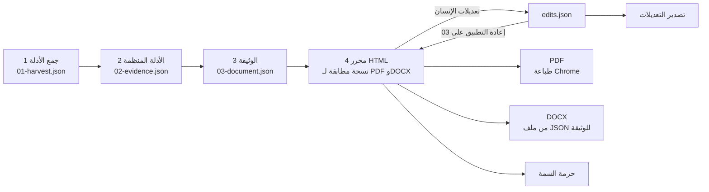

# 01 · خط الإنتاج من أوله إلى آخره (عربي) — الملف المقابل: 01-pipeline.md

**الخلاصة:** خمس نقاط حفظ، كل منها ملف تقرؤه المرحلة التالية، فيعيد أي تغيير تشغيل مرحلة واحدة لا المراحل كلها. والمرحلة المكلفة (جمع الأدلة) هي التي لا تكاد تكرر.

| # | نقطة الحفظ | ما تحمله | متى يعاد تشغيلها |
|---|---|---|---|
| 1 | `01-harvest.json` | ما رصد: عناصر النموذج لكل لغة ولكل فرع، والمرفقات لكل فرع، وسجل الخدمة، وجولة المكاتب، ونموذج سير العمل، وأي وثيقة سابقة مسلمة | عند إعادة جمع الأدلة أو تغير الخدمة |
| 2 | `02-evidence.json` | الحقائق نفسها بعد التنظيم، **ولكل منها `source`**، ومعها كل فجوة؛ وسجل الأدلة (أدناه) | عند تغير الأدوار أو الشاشات أو القصص أو المتطلبات أو القواعد أو المخطط أو قاعدة استخراج |
| 3 | `03-document.json` | الوثيقة موزعة على فصول القالب: `control` و`revisions` و`approvals` و`chapters[].sections[].blocks[]` (`prose` و`table` و`figure` و`stories`) و`openQuestions` | عند تغير الصياغة أو الترتيب أو نص قسم |
| 4 | محرر HTML | القالب وملف الأنماط نفسهما اللذان تطبع منهما PDF، مع أدوات التحرير؛ يقرأ `03-document.json` و`edits.json` و`theme.json` | عند أي تغيير مما سبق أو تغير السمة |
| 5 | التصدير | PDF (طباعة Chrome لملف HTML نفسه)، وDOCX (يبنى من ملف JSON المعدل، لا من HTML ولا من PDF)، و`edits.json`، وحزمة السمة | عند أي تعديل أو تغير السمة |

## قواعد المراحل
- **المرحلة 1 لا تشغل النظام الحي.** تجمع ما أنتجته أدوات الجمع وتسمي الناقص، ليشغل الجمع المناسب عن قصد.
- **قبل طباعة فجوة، ابحث عن الملف بالاسم الذي يحتمل أن يحمله** (أسماء بطول المسار، أو بادئات، أو معرف آخر).
- **سجل الأدلة يسبق كل اشتقاق.** كل عنصر من عناصر سير العمل تعرفه أي جهة مصدر (نموذج العملية، والوثيقة السابقة، وجولة الموقع، وسجل الخدمة) يدخل قائمة واحدة مع `presentIn` وتسمية كل مصدر وتصنيف واحد: `drawn` أو `drawn-unobserved` أو `document-only` أو `not-a-stage`. الصف بلا تصنيف يسقط البناء.
- **الدمج اتحاد لا اختيار.** حين يصف مصدران عنصرا واحدا، يحتفظ بكل حقل ذكره أي منهما؛ ويغلب المصدر الأقوى في الحقل الذي يذكره كلاهما (جولة الموقع ثم سجل الخدمة ثم نموذج العملية ثم الوثيقة السابقة، في التسميات). الدمج بالاختيار يسقط حقول المصدر الأضعف بصمت.
- **حقيقة واحدة، قائمة واحدة، تحسب مرة واحدة** قبل أن يقرأها أي مستهلك. المستهلكون الذين يقرأ كل منهم مصدره سيختلفون في النهاية.
- **رمز الوثيقة يستعلم عنه ولا يشتق.** غياب مدخل الرمز توقف إلزامي.
- **أي تغيير في خط الإنتاج تغيير في كل الوثائق.** إصلاح في محرك العرض لا يعمم يترك مجموعة لم تعد مجموعة.

## حلقة التعديل
1. يفتح المحرر `03-document.json` بالنسخة المختارة (العربية من اليمين إلى اليسار، والإنجليزية من اليسار إلى اليمين).
2. يعدل الشخص النص في مكانه، أو ينقل الكتل والصفوف والفقرات أو يكررها أو يدرجها أو يحذفها. كل إجراء عملية واحدة في `edits.json` (`04-edits-contract.ar.md`).
3. التراجع والإعادة يسيران على قائمة العمليات. ولا يمس `03-document.json`.
4. يعيد التصدير تطبيق العمليات على نسخة من ملف JSON للوثيقة (ويرفض إن اختلف `baseHash`)، ثم يطبع PDF ويبني DOCX ويشغل فحوص المخرجات.
5. التعديل المتكرر خلل في المنبع: أصلح المصدر (قواعد المراحل 1 إلى 3 أو ملف تصحيحات خاص بالوثيقة)، لا ملف التعديلات.

## النسختان
تبنى النسختان من الأدلة نفسها، بملف JSON للوثيقة لكل لغة. يحمل جذر HTML السمتين `lang` و`dir` (`ar`/`rtl` و`en`/`ltr`)، ويستخدم التخطيط الخصائص المنطقية (`margin-inline-start` و`text-align: start`) ليخدم ملف أنماط واحد النسختين، وفي المحرر مبدّلان: اللغة «ع» / «E» (الواجهة والنسخة)، واتجاه التخطيط RTL / LTR (مستقل عن اللغة، يتبعها حتى يختار المستخدم ثم يُحفظ اختياره، وللعرض فقط، فالتصدير يبقي اتجاه النسخة). يسمي ملف التعديلات لغته في `locale` وينطبق على تلك النسخة. والزوج وحدة واحدة: أي تغيير في البنية (نقل أو إدراج أو حذف أو تكرار) في نسخة يجرى في الأخرى قبل التصدير، ويقارن فحص التصدير بنية النسختين (الفصول والأقسام وأنواع الكتل وعدد الصفوف نفسها).

