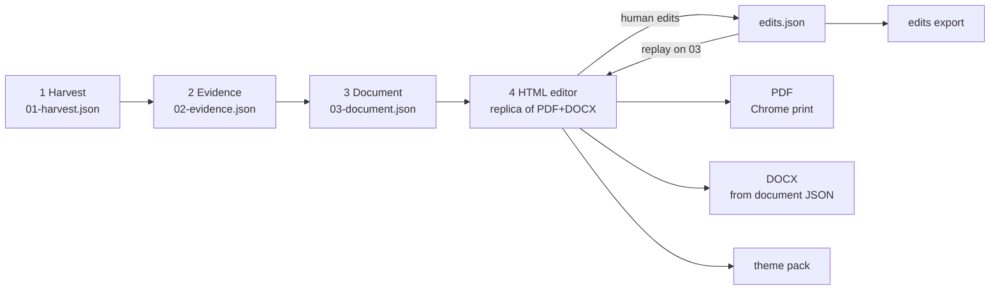

# 01 · The pipeline end to end (EN) — pair: 01-pipeline.ar.md

**Verdict:** five checkpoints, each a file the next stage reads, so a change re-runs one stage instead of all. The expensive stage (harvest) is the one you almost never repeat.

| # | Checkpoint | Holds | Re-run when |
|---|---|---|---|
| 1 | `01-harvest.json` | what was observed: form controls per locale and branch, attachments per branch, the service record, the desk walk, the process model, any delivered earlier document | a harvest was re-run or the service changed |
| 2 | `02-evidence.json` | the same facts normalised, **each with its `source`**, plus every gap; the evidence ledger (below) | roles, screens, stories, requirements, rules, the figure, or an extraction rule changed |
| 3 | `03-document.json` | the document laid onto the template's chapters: `control`, `revisions`, `approvals`, `chapters[].sections[].blocks[]` (`prose`, `table`, `figure`, `stories`), `openQuestions` | wording, ordering, section text |
| 4 | HTML editor | the same template and CSS the PDF prints, plus editing controls; reads `03-document.json` + `edits.json` + `theme.json` | any of the above, or a theme change |
| 5 | exports | PDF (Chrome print of the same HTML), DOCX (built from the edited document JSON, never from HTML or PDF), `edits.json`, theme pack | an edit or a theme change |

## Stage rules
- **Stage 1 does not drive the live system.** It joins what harvest tools already produced and names what is missing, so the right harvest is run on purpose.
- **Before printing a gap, look for the file under the name it would plausibly have** (route-length names, prefixes, another slug).
- **The evidence ledger comes before anything is derived.** Every workflow element every source knows (process model, earlier document, site walk, service record) goes into one list with `presentIn`, each source's caption, and one disposition: `drawn`, `drawn-unobserved`, `document-only`, `not-a-stage`. A row with no disposition fails the build.
- **Union, never select-one.** Where two sources describe one element, keep every field either states; the stronger source wins a field both state (site walk › service record › process model › earlier document, for a caption). A select-one merge silently drops the weaker source's fields.
- **One fact, one list, computed once,** before any consumer reads it. Several consumers each reading their own source will eventually disagree.
- **The document code is looked up, never derived.** A missing code entry is a hard stop.
- **A pipeline change is a change to every document.** A renderer fix not rolled out leaves a set that is no longer a set.

## The edit loop
1. The editor opens `03-document.json` in the chosen edition (AR = RTL, EN = LTR).
2. The person edits text in place, or moves, duplicates, inserts and deletes blocks, rows and paragraphs. Each action is one op in `edits.json` (`04-edits-contract.md`).
3. Undo/redo walks the op list. Nothing touches `03-document.json`.
4. Export replays the ops on a copy of the document JSON (refusing if `baseHash` differs), then prints the PDF, builds the DOCX and runs the output gates.
5. A recurring edit is a defect upstream: fix the source (stage 1–3 rules or a per-document corrections file), not the edits file.

## Editions
Both editions are built from the same evidence, one document JSON per locale. The HTML root carries `lang` and `dir` (`ar`/`rtl`, `en`/`ltr`); layout uses logical properties (`margin-inline-start`, `text-align: start`) so one stylesheet serves both, and the editor has two switches: language «ع» / «E» (interface and edition) and text direction RTL / LTR (independent; follows the language until the user chooses, then remembered; view only, exports keep the edition's direction). Since 0.10.0 the editor's own layout never flips: toolbar, panels, page and watermark keep the default right-to-left arrangement and only the words change direction. An edits file names its `locale` and applies to that edition. The pair is the unit: a structural change (move, insert, delete, duplicate) made in one edition is made in the other before export, and the export gate compares the two editions' structure (same chapters, sections, block kinds and row counts).
