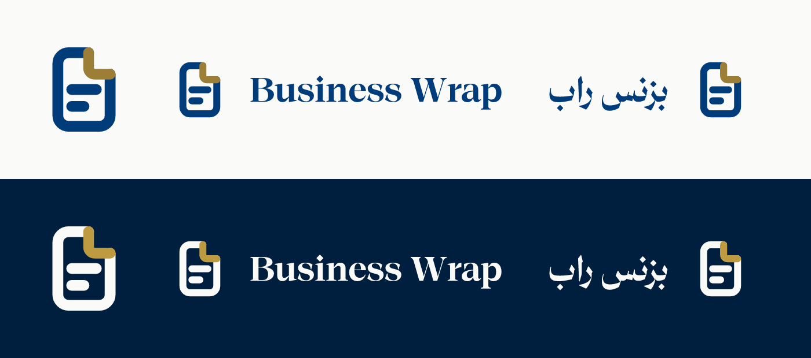

# Business-Wrap identity (EN) — pair: README.ar.md

**Verdict:** one mark, a page drawn as a single open stroke (the *wrap*) whose seam is the folded corner in gold, with two lines of text inside. It is the tool's brand only and never appears in a document output (PDF, DOCX, print, edits JSON, theme pack, Save-HTML export).

## Why this mark
- **Family:** built on the same grammar as QA Wrap: a 64 grid, one 7-unit stroke with round caps and joins, an open shape that "wraps", and one accent that comes out of the seam (QA Wrap: ring + check; Business-Wrap: page + fold).
- **Meaning:** the folded corner is the universal document cue; making the fold the accent stroke that closes the wrap is what makes it ours, not a stock file icon.
- **Colour:** the delivered documents' own palette: primary `#003c7a` (light ink), accent `#9c7e36` on light / `#be9a41` on dark, dark ground `#001e3d` (the cover band). The light accent is the 600 step because it keeps 3:1 against paper as a graphic.
- **Type:** Thmanyah Serif Display Bold, converted to outlines (no font file ships).
- **Arabic name:** «بزنس راب», a transliteration. Sibling tools keep their Latin name in Arabic text, and a translated name («غلاف الأعمال») would be a second brand; the transliteration keeps one name in both scripts.

## Files
| Path | Use |
|---|---|
| `logo/mark.svg`, `logo/mark-dark.svg` | icon only, light and dark grounds |
| `logo/mark-animated.svg` | toolbar mark: reveal on load, corner lift on hover/focus; respects reduced motion |
| `logo/lockup-en.svg`, `logo/lockup-ar.svg` (+ `-dark`) | horizontal lockups; AR puts the mark on the start (right) side |
| `logo/favicon.svg` | follows the system colour scheme |
| `png/mark-{16…512}.png`, `png/mark-dark-{16…512}.png` | app/favicon tiles (rounded ground), no metadata |
| `build.py` | regenerates everything from `palette/tokens.json` and the local font |

Animated mark hooks: it reveals on its own when loaded as an image; inline it and add class `bw-still` to stop the reveal, `bw-reveal` to replay it, `bw-hover` to hold the lifted corner. Colours follow `--bw-ink` / `--bw-accent` when inlined.

## Rules
| Rule | Value |
|---|---|
| Clear space | ¼ of the mark's height on every side (16 units on the 64 grid) |
| Minimum size | mark 16 px (favicon tile) / 20 px inline; lockup 24 px high |
| Grounds | light on paper `#fafaf9` or white; dark on `#001e3d` or darker |

| Do | Don't |
|---|---|
| Use the files as they are | Redraw, stretch, outline or add shadows |
| Keep the fold in the accent colour | Recolour the fold to the ink colour, or the page to gold |
| Use the dark files on dark grounds | Put the light mark on photos or mid-tones |
| Keep the mark the same in Arabic | Mirror the mark for RTL (only the lockup order changes) |
| Use it for the tool (UI, README, docs, store) | Place it in a document output or a logo slot |
