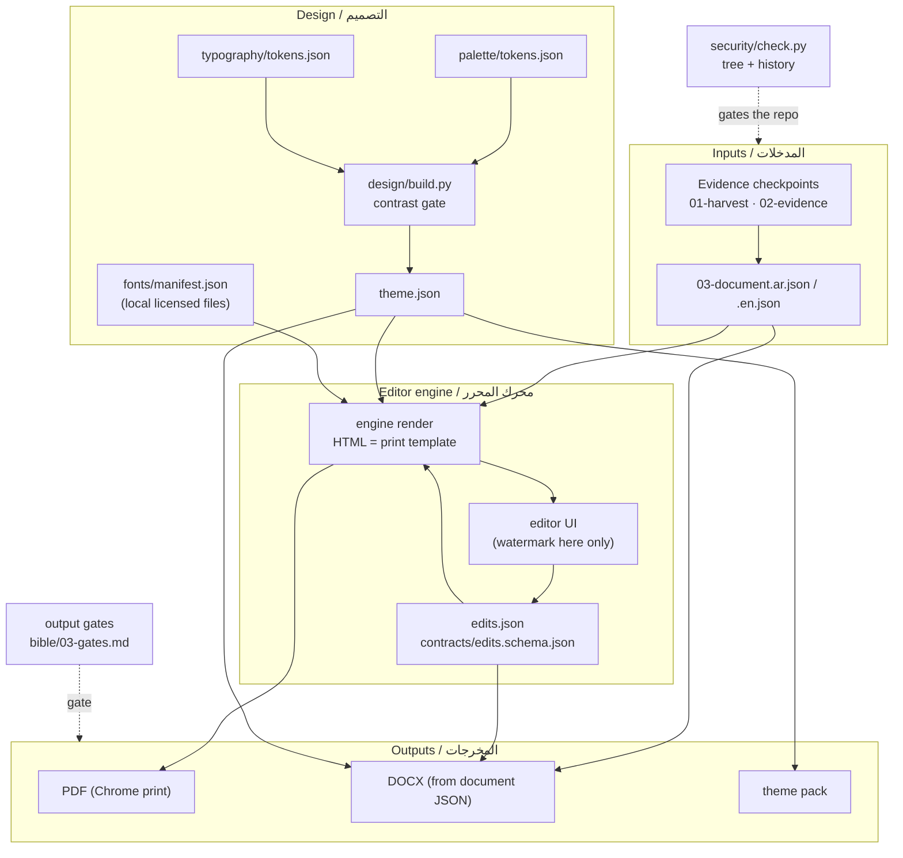

# Architecture / البنية

EN: what lives where, and which way data flows. Folder ownership: `engine/`, `editor/`, `samples/`, `tests/` (editor engine); everything else (bible, tokens, design, fonts, logos, security, docs).

عربي: ما الذي يقيم أين، وفي أي اتجاه تسير البيانات. ملكية المجلدات: `engine/` و`editor/` و`samples/` و`tests/` (محرك المحرر)؛ وكل ما عداها (المرجع والرموز والتصميم والخطوط والشعارات والأمان والتوثيق).

