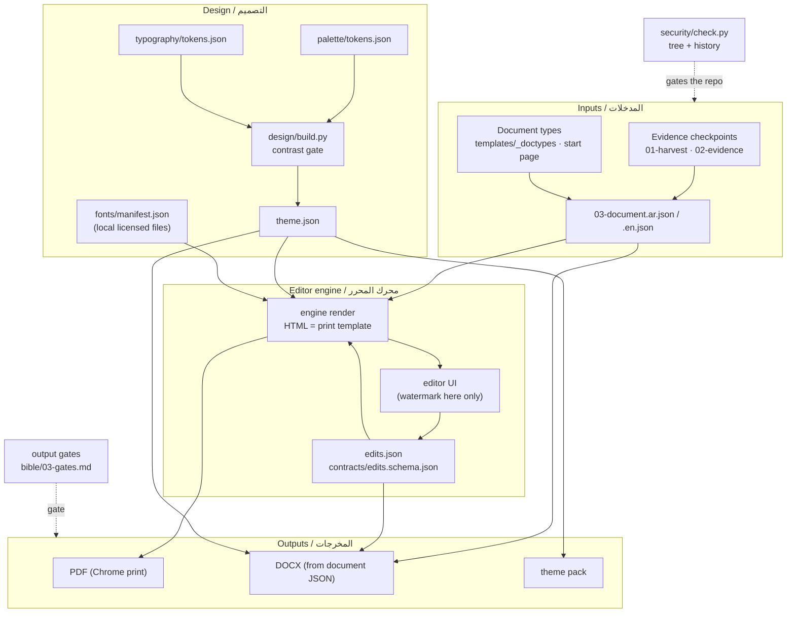

# Architecture / البنية

EN: what lives where, and which way data flows. Folder ownership: `engine/`, `editor/`, `samples/`, `tests/` (editor engine); everything else (bible, tokens, design, fonts, logos, security, docs).

عربي: ما الذي يقيم أين، وفي أي اتجاه تسير البيانات. ملكية المجلدات: `engine/` و`editor/` و`samples/` و`tests/` (محرك المحرر)؛ وكل ما عداها (المرجع والرموز والتصميم والخطوط والشعارات والأمان والتوثيق).

## Document types (0.18.0) / أنواع الوثائق

EN: a document type is a starter document in `templates/_doctypes/<id>/` (`type.json` for the look and names, `en.json` and `ar.json` for the content). `engine/doctypes.mjs` reads the folder and composes the final document (`compose`); the same module feeds the start page (the `bw-doctypes` payload embedded in the editor, or `GET /api/doctypes` from the local host) and the command line (`business-wrap types`, `business-wrap new --type <id>`). From there the document is an ordinary document: it goes through the same renderer, the same edits contract and the same export gates as one built from evidence. Detail: [bible/14-document-types.md](../bible/14-document-types.md).

عربي: نوع الوثيقة وثيقة ابتدائية في `templates/_doctypes/<id>/` (الملف `type.json` للمظهر والأسماء، و`en.json` و`ar.json` للمحتوى). تقرأ الوحدة `engine/doctypes.mjs` المجلد وتبني الوثيقة النهائية (`compose`)، وتغذي الوحدة نفسها صفحة البداية (حمولة `bw-doctypes` المضمنة في المحرر، أو `GET /api/doctypes` من الخادم المحلي) وسطر الأوامر (`business-wrap types` و`business-wrap new --type <id>`). ومن هناك تصبح وثيقة عادية: تمر بمحرك العرض نفسه وعقد التعديلات نفسه وفحوص التصدير نفسها كأي وثيقة بنيت من الأدلة. التفاصيل: [bible/14-document-types.ar.md](../bible/14-document-types.ar.md).

